# 🚀 LG Electronics · Gemini Enterprise & Antigravity 2.0 실무 핸즈온 가이드

> <strong>Step-by-Step 실습 가이드</strong>  
> 각 단계마다 <strong>① 화면에서 어디를 보는지</strong> ➔ <strong>② 무엇을 복사해 입력하는지</strong> ➔ <strong>③ 어떤 결과 화면이 나오는지</strong> 순서대로 따라오시면 됩니다.

---

## 🗺️ 0. 오늘 함께 완성할 5단계 누적 빌드업 로드맵 (총 3시간)

<strong>1부(크롬 웹, 1시간)</strong>에서는 주간 보고서를 자동 작성해 지메일 임시보관함에 넣고, <strong>2부(Antigravity 앱, 2시간)</strong>에서는 웹페이지(`index.html`) 하나에 <strong>[탭 1: 발표 슬라이드] ➔ [탭 2: 실시간 주가·뉴스] ➔ [탭 3: 가전 실적 차트] ➔ [마지막 탭: 🧠 AI 군집·디시전트리·회귀예측]</strong>을 차례대로 붙여 나만의 업무 포털을 완성합니다.

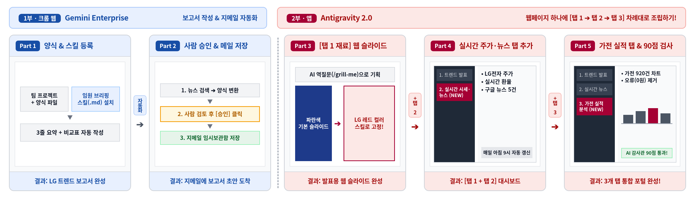

| 파트 (시간) | 실습 환경 | 내가 직접 만드는 누적 산출물 |
| :--- | :---: | :--- |
| <strong>Part 1 (30분)</strong> | 🌐 크롬 GE Web | <strong>`Knowledge` 보고서 + `Skills`(`.md`·텍스트 직접 등록) + 개인화·메모리 + 멀티 모델 비교 + `Nano Banana` 이미지·`Veo 3.1` 영상 생성</strong> |
| <strong>Part 2 (30분)</strong> | 🌐 크롬 GE Web | <strong>HITL 승인(`Approval`) Gmail 자동화 `Workflow` + 노코드 `채팅 에이전트`(`@멘션`·하위 에이전트) + 자연어 정기 스케줄(`Schedule`) 자동화</strong> |
| <strong>Part 3 (30분)</strong> | 💻 Antigravity 2.0 | <strong>LG 브랜드 컬러(`#A50034` 레드 + 화이트) 고정 웹 슬라이드(`index.html`)</strong> |
| <strong>Part 4 (30분)</strong> | 💻 Antigravity 2.0 | <strong>좌측 사이드 탭 업무 포털 (`탭 1: 트렌드 슬라이드` + `탭 2: 실시간 시세·뉴스`)</strong> |
| <strong>Part 5 (40분)</strong> | 💻 Antigravity 2.0 | <strong>`탭 3: 가전 실적·구독 분석` + `마지막 탭: 🧠 AI 그로스·ML 분석(군집·디시전트리·회귀예측)` + `임원 보고용 엑셀(.xlsx)·PPTX(.pptx) 추출` + `90점 품질 게이트`</strong> |
| <strong>🎁 Bonus (20분)</strong> | 💻 Antigravity 2.0 | <strong>[파워 팁 리뷰 & 미니 실습] `/` 명령어 · `@conversation` · `@rule` 총정리 + 💱 `generative_ui` 환율 계산기 앱 + 🧩 `/plugin` 패키징 + `/goal` · `/btw` + 🤝 `/boost` · `/teamwork` 멀티 에이전트</strong> |

---

## 📦 실습 전 준비: 실습 파일 한 번에 다운로드 (`LG_Workshop_Files.zip`)

> <strong>📥 번거롭게 하나씩 받지 마세요!</strong> 아래 버튼을 누르면 오늘 실습에 쓰이는 <strong>6개 파일 전체가 압축된 `LG_Workshop_Files.zip`</strong>이 내 PC로 즉시 다운로드됩니다. 다운로드 후 압축을 풀어 작업 폴더(예: `lg-work-portal`)에 넣어두세요.
>
> 👉 <a href="./LG_Workshop_Files.zip" download="LG_Workshop_Files.zip"><strong>[📥 실습 파일 6종 전체 ZIP 한 번에 다운로드 (LG_Workshop_Files.zip)]</strong></a>

<details class="file-list-details">
<summary><strong>📂 개별 실습 파일 6종 상세 설명 및 개별 다운로드 보기 (클릭하여 펼치기)</strong></summary>

| 번호 | 파일명 (클릭 시 열기) | 사용 파트 | 파일 역할 및 핵심 내용 |
| :---: | :--- | :---: | :--- |
| <strong>01-A</strong> | [`01_GE_Workflow_lg_weekly_report_template.txt`](./files/01_GE_Workflow_lg_weekly_report_template.txt) | <strong>Part 1</strong> | 크롬 GE `Project Knowledge`에 업로드할 <strong>사내 주간 트렌드 보고서 표준 서식 (`.txt`)</strong> |
| <strong>01-B</strong> | [`01_GE_Skill_lg_executive_briefing_SKILL.md`](./files/01_GE_Skill_lg_executive_briefing_SKILL.md) | <strong>Part 1</strong> | 크롬 GE `Skills` ➔ `Upload skill`에 업로드해 `/lg-executive-briefing`으로 호출하는 <strong>임원 브리핑 스킬 (`.md`)</strong> |
| <strong>01-C</strong> | [`01_GE_Workflow_lg_weekly_report_template.md`](./files/01_GE_Workflow_lg_weekly_report_template.md) | <strong>Part 2</strong> | 크롬 GE `Workflow` 노드의 `Files`에 첨부파일로 넣을 <strong>사내 주간 트렌드 보고서 마크다운 템플릿 (`.md`)</strong> |
| <strong>02</strong> | [`02_AG_Webpage_lg_brand_slides_SKILL.md`](./files/02_AG_Webpage_lg_brand_slides_SKILL.md) | <strong>Part 3</strong> | 매번 랜덤으로 나오는 슬라이드 색감을 <strong>LG 시그니처 레드(`#A50034`) + 화이트 배경</strong>으로 고정하는 스킬 |
| <strong>03</strong> | [`03_AG_Dashboard_fetch_lg_live_market.py`](./files/03_AG_Dashboard_fetch_lg_live_market.py) | <strong>Part 4</strong> | LG전자(`066570`) 현재가·환율·구글 뉴스 실시간 수집 코드 |
| <strong>04</strong> | [`04_AG_Analytics_lg_appliance_data.csv`](./files/04_AG_Analytics_lg_appliance_data.csv) | <strong>Part 5</strong> | 5대 가전(`OLED evo`·`워시타워`·`디오스`·`HVAC`·`스탠바이미`) <strong>920행 실적·구독·ThinQ 데이터</strong> |

</details>

---

# 🌐 [1부 · 크롬 브라우저] Part 1. GE - Project · Knowledge & Skill (`.md` 설치)
### 🔹 Step 1-1. 새 프로젝트(`Project`) 생성 및 팀원 공유하기

> <strong>🎯 핵심 포인트:</strong> 팀 전용 <strong>`Project`</strong>를 만들고 팀원을 초대하면, 내가 올린 보고서 양식을 팀원 모두가 똑같이 쓸 수 있습니다.

1. 크롬에서 <strong>Gemini Enterprise</strong> 접속 ➔ 좌측 메뉴 <strong>`Projects` ➔ `[+ New Project]`</strong> 클릭
2. 프로젝트 이름(예: `LG` 또는 `LG-Market-Trends`)과 간단한 <strong>`Description`(설명)</strong>을 적당히 입력하고, 우측 상단 <strong>`Invite+`</strong> 버튼을 눌러 팀원 이메일 추가 (권한: <strong>`Editor`</strong>)
3. 좌측 사이드바 <strong>`Team`</strong> 메뉴에서 초대된 팀원이 정상 추가되었는지 확인

👉 **화면 확인 포인트:** (`우측 상단 Invite 버튼 & 좌측 Knowledge / Team 메뉴`)
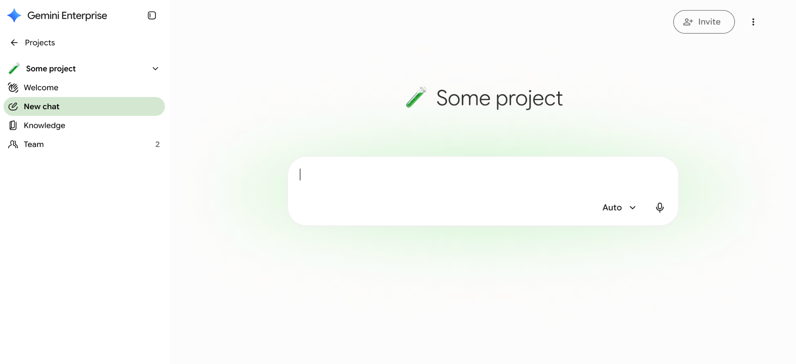

---

### 🔹 Step 1-2. 프로젝트 `Knowledge`(양식 파일) 등록 & 주간 트렌드 보고서 생성

> <strong>🎯 핵심 포인트:</strong> <strong>`Knowledge`</strong>에 보고서 양식 파일(`.txt`)을 한 번만 올려두면, 매번 길게 지시하지 않아도 알아서 회사 양식대로 보고서를 써줍니다.

1. 좌측 사이드바 <strong>`Knowledge`</strong> 메뉴 ➔ 우측 <strong>`Upload` (`Add`)</strong> 클릭 ➔ <strong>`Upload files`</strong>에서 실습 파일 <strong>[`01_GE_Workflow_lg_weekly_report_template.txt`](./files/01_GE_Workflow_lg_weekly_report_template.txt)</strong>를 추가하고 <strong>`Description`(설명)</strong>도 적당히 입력해 저장 *(또는 `Paste text`로 내용 붙여넣기)*
2. 업로드가 완료되면 <strong>`New chat`</strong>을 눌러 아래 프롬프트를 그대로 복사해 입력합니다:

```text
최근 1개월간 LG 전자 프리미엄 시장 트렌드를 조사해서 프로젝트 Knowledge에 등록된 주간 트렌드 보고서 템플릿 양식으로 출력해줘
```

👉 **실행 결과 화면:** (`01_GE_Workflow_lg_weekly_report_template.txt` 서식이 자동 반영된 보고서)
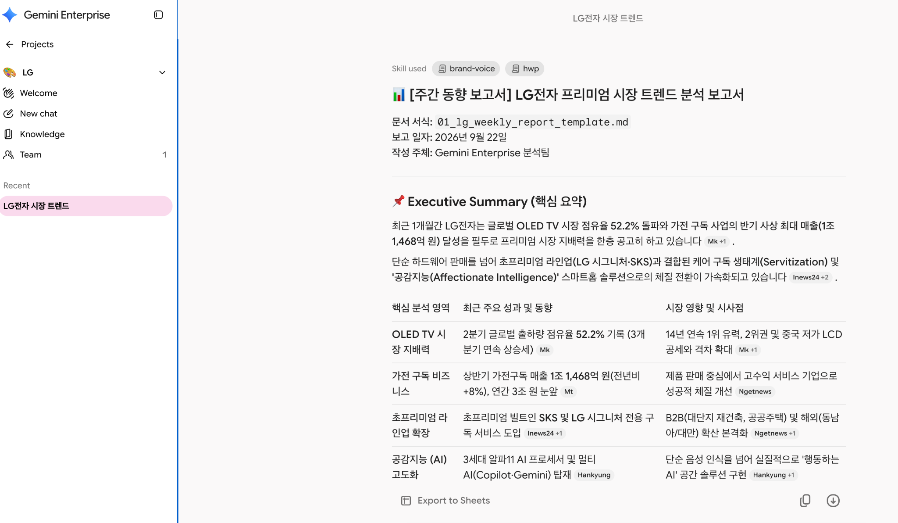

---

### 🔹 Step 1-3. [GE Skill 실습] `.md` 파일 업로드 & 직접 텍스트 입력으로 나만의 Skill 등록·호출하기

> <strong>🎯 `Knowledge` vs `Skills` 한 줄 차이:</strong>  
> * <strong>`Knowledge`</strong>: 이 프로젝트 안에서만 참고하는 배경 자료  
> * <strong>`Skills`</strong>: 내 계정에 설치해 두고 <strong>어느 채팅창에서든 `/스킬이름` 한 줄로 바로 불러 쓰는 나만의 단축키</strong>

| 스킬 등록 방식 | 진입 메뉴 | 특징 및 추천 상황 |
| :--- | :--- | :--- |
| **방식 A. 파일 업로드 (`Upload skill`)** | `Skills` ➔ `+` ➔ **`⬆️ Upload skill`** | 미리 만들어진 표준 `.md` 또는 `.zip` 스킬 파일을 그대로 가져와 팀 전체가 동일한 양식을 쓸 때 |
| **방식 B. 직접 텍스트 입력 (`Create skill`)** | `Skills` ➔ `+` ➔ **`✨ Create skill`** | 별도 파일 없이 화면에서 **`① 이름*` · `② 설명*` · `③ 안내(지침)`**를 텍스트로 바로 타이핑해 30초 만에 나만의 스킬을 만들 때 |

---

#### 📌 [실습 A — 파일 업로드 방식] `.md` 파일 업로드로 `/lg-executive-briefing` 스킬 설치하기

<details class="file-list-details">
<summary><strong>📄 (참고) 실습 스킬 파일 내용 미리보기 (`01_GE_Skill_lg_executive_briefing_SKILL.md` — 클릭하여 펼치기)</strong></summary>

```markdown
---
name: lg-executive-briefing
description: "LG전자 가전 및 TV 시장 뉴스를 임원 보고용 3줄 핵심 요약, 당사 vs 경쟁사 비교표, 출처 검증 포맷으로 즉시 변환하는 스킬"
---

# LG전자 임원 보고용 시장 트렌드 브리핑 스킬 (lg-executive-briefing)

사용자가 제품군이나 시장 트렌드 주제를 입력하면, 항상 아래 3단 표준 구조로만 간결하고 명확하게 보고서를 작성하세요.

## 1. 📌 [Executive Summary] 경영진 3줄 핵심 요약
- 결론부터 두괄식으로 3줄 이내로 핵심 시장 변화와 당사 시사점을 요약합니다.
- 모든 제품명은 'LG 올레드 에보(LG OLED evo)', 'LG 워시타워(WashTower)'처럼 국문과 영문을 첫 등장 시 병기합니다.

## 2. 📊 당사 vs 주요 경쟁사 핵심 트렌드 비교표
반드시 아래 마크다운 표 컬럼을 유지하여 작성하세요:
| 제품군 | 글로벌 시장 핵심 동향 (수치 포함) | 주요 경쟁사 동향 | LG전자 차별화 포인트 및 전략 | 인라인 출처 ([매체명, 날짜]) |

## 3. 💡 실무 액션 아이템 (Next Steps)
- 현업 부서(상품기획·마케팅·영업)에서 즉시 검토해야 할 후속 조치 2가지를 체크리스트(`- [ ]`) 형태로 제시합니다.
```

</details>

##### 1️⃣ `Skills` ➔ `+ (Add skill)` ➔ `Upload skill`에서 `.md` 파일 업로드하기
1. 좌측 메뉴에서 <strong>`📄 Skills`</strong>를 클릭합니다.
2. 상단 <strong>`+` (`Add skill`)</strong> 버튼(또는 초기 화면의 `Upload skill` 버튼)을 누르고 메뉴에서 <strong>`⬆️ Upload skill`</strong>을 선택합니다.
3. **`Import skill`** 팝업창(`Supports .md and .zip files`)에서 **`Browse files`**를 눌러 실습 파일 <strong>[`01_GE_Skill_lg_executive_briefing_SKILL.md`](./files/01_GE_Skill_lg_executive_briefing_SKILL.md)</strong>를 선택한 뒤 파란색 <strong>`Import`</strong> 버튼을 클릭합니다. *(여러 참조 파일이 포함된 스킬은 `SKILL.md`가 들어있는 `.zip` 파일로도 동일하게 업로드할 수 있습니다.)*

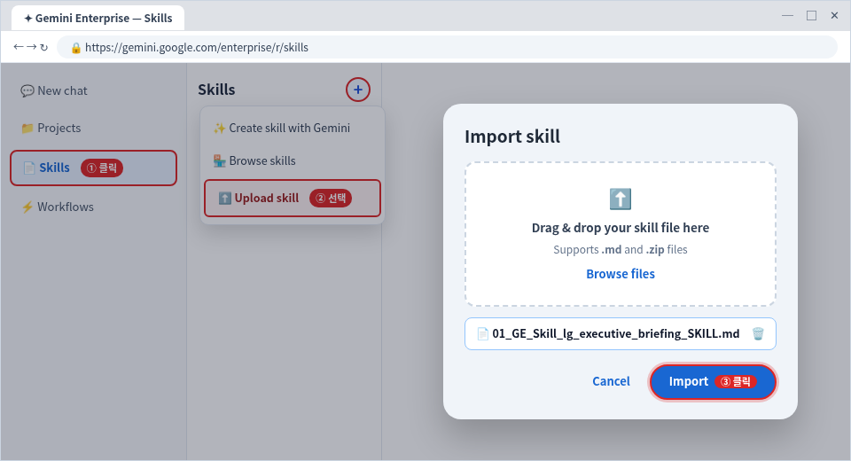

##### 2️⃣ 설치된 `lg-executive-briefing` 스킬 확인 & `New chat` 클릭
* 업로드 즉시 좌측 `Enabled` 목록에 <strong>`📄 lg-executive-briefing`</strong>이 등록되고 트리거 명령어(<strong>`/lg-executive-briefing`</strong>)가 생성됩니다. 우측 상단의 파란색 <strong>`✏️ New chat`</strong> 버튼을 클릭합니다. *(옆의 `Share` 버튼으로 조직 내 동료에게 스킬을 공유할 수도 있습니다.)*

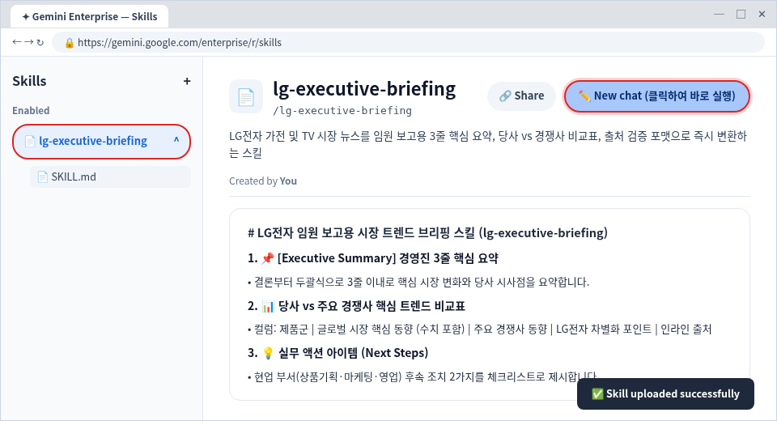

##### 3️⃣ 채팅창에서 `/lg-executive-briefing` 스킬 칩으로 1줄 브리핑 실행하기
* 채팅 입력창에 **`/lg-executive-briefing`** 칩이 자동 삽입된 상태에서(또는 일반 채팅창에서 `/`를 쳐서 스킬 선택 후), 아래 한 줄만 입력해 실행합니다:

```text
/lg-executive-briefing 북미 프리미엄 OLED TV 및 AI 워시타워 최근 시장 트렌드 브리핑해줘.
```

👉 **실행 결과 화면:** (긴 양식 설명 없이도 스킬에 정의된 `[1. 경영진 3줄 요약 ➔ 2. 당사 vs 경쟁사 비교표 ➔ 3. 실무 액션 아이템]` 3단 구조로 즉시 출력!)
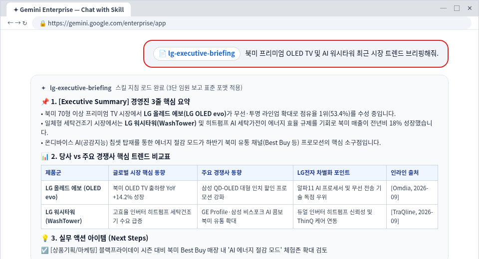

---

#### ✍️ [실습 B — 직접 텍스트 입력 방식] 파일 없이 화면에서 텍스트만 쳐서 30초 만에 나만의 스킬 등록하기

> <strong>💡 핵심 포인트:</strong> `.md` 파일을 따로 만들 필요 없이, 웹 화면에서 **`이름*` · `설명*` · `안내(지침)` 3칸만 텍스트로 채우고 `저장`을 누르면** 즉시 `/스킬이름` 단축키가 만들어집니다!

##### 4️⃣ `Skills` ➔ `+ (Add skill)` ➔ `Create skill` 클릭 후 텍스트 직접 입력 & `저장`
1. 좌측 메뉴 **`📄 Skills`** 상단의 **`+`** 버튼을 누르고 **`✨ Create skill` (스킬 만들기)**을 선택합니다.
2. 아래 화면처럼 우측 입력창의 **3가지 항목**을 직접 타이핑하고 우측 상단 파란색 **`저장`** 버튼을 클릭합니다:
   - **`① 이름*`** (`64자 이내`, 영문 소문자·숫자·하이픈 `-`만 사용): 예) **`my-skill`** ➔ 저장 즉시 채팅창에서 **`/my-skill`**로 호출됩니다.
   - **`② 설명*`** (`1,024자 이내`, 스킬의 역할 한 줄 요약): 예) **`항상 객관성을 유지하는 스킬`**
   - **`③ 안내`** (AI에게 부여할 역할·말투·보고서 양식 등 평문 지침): 예) **`항상 객관성을 유지해서 팩트 위주로 전달`**
   - *(💡 **선택 팁**: 직접 타이핑하는 대신 좌측 하단 **`🛡️ 기능 설명`** 입력창에 "어떤 스킬을 만들어줘"라고 말로 지시해서 우측 칸을 자동으로 채울 수도 있습니다!)*

👉 **화면 확인 포인트:** (`① 이름*(my-skill)` ➔ `② 설명*` ➔ `③ 안내(지침 본문 텍스트 입력)` ➔ 우측 상단 `④ 저장` 클릭)
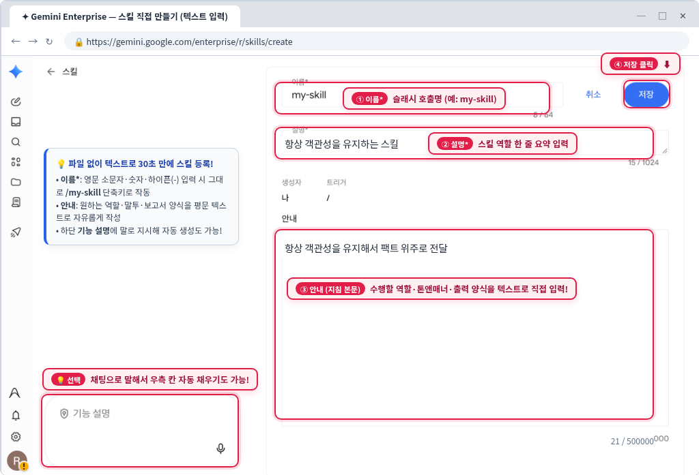

##### 5️⃣ [복사해서 바로 쓰는 텍스트 스킬 레시피 3선] 원하는 레시피를 골라 그대로 붙여넣어 보세요!

* **[레시피 1 — ⚡ 초간단 '객관적 팩트 점검' 스킬 (`/my-skill` · 위 화면 예제 그대로 체험)]**
  - **이름\***: `my-skill`
  - **설명\***: `항상 객관성을 유지하는 스킬`
  - **안내**:
```text
항상 객관성을 유지해서 팩트 위주로 전달
```

* **[레시피 2 — 💼 CFO 수익성·리스크 압박 질문기 (`/lg-cfo-check`)]**
  - **이름\***: `lg-cfo-check`
  - **설명\***: `기획안이나 보고서의 낙관적 전망에 대해 원가·수익성·관세 리스크와 예상 압박 질문을 짚어주는 스킬`
  - **안내**:
```text
사용자가 입력한 기획안이나 보고서에 대해 좋은 말은 생략하고, 1) 수익성·원가·환율 관점의 치명적 허점 3가지, 2) 임원 보고 시 나올 날카로운 압박 질문 2개와 방어 답변만 간결하게 제시하라.
```

* **[레시피 3 — 📌 임원 보고용 3줄 두괄식 압축기 (`/lg-3line-summary`)]**
  - **이름\***: `lg-3line-summary`
  - **설명\***: `길고 복잡한 회의록이나 뉴스 기사를 임원 보고용 두괄식 3줄 요약과 후속 액션으로 압축하는 스킬`
  - **안내**:
```text
입력된 내용을 무조건 1) 핵심 결론 1줄(수치 포함), 2) 당사 영향 및 시사점 1줄, 3) 즉시 실행할 액션 아이템 1줄의 총 3줄 불릿으로만 압축해서 출력하라.
```

##### 6️⃣ 채팅창에서 방금 텍스트로 등록한 `/my-skill` 바로 호출해보기
* **`저장`** 버튼을 누른 뒤 새 채팅창(`New chat`)으로 가서 **`/my-skill`**(또는 방금 만든 스킬 이름)을 입력하고 `[Tab]` 키로 선택한 뒤 아래 문장을 넣어 말투와 분석 관점이 즉시 바뀌는지 확인합니다:

```text
/my-skill 우리 팀이 이번에 '모든 가전 라인업 가격을 조건 없이 20% 일괄 인상하는 기획안'을 올리려는데 어떻게 생각해?
```

---

### 🔹 Step 1-4. ⚙️ [개인화 & 도구 탐색] `개인화·메모리` 설정 & 입력창 `5대 도구(Tools)` 익히기

> <strong>🎯 핵심 포인트:</strong> 본격적인 실습 전에 <strong>① 내 부서·직무 프로필과 메모리(`Memory`)를 켜두면</strong> 매번 배경 설명을 반복하지 않아도 내 직무에 맞춘 답변이 나오고, <strong>② 입력창 하단 `도구(Tools)` 버튼</strong>에서 웹 검색·Canvas·Deep Research·이미지·동영상 생성을 바로 꺼내 쓸 수 있습니다.

#### 1️⃣ 좌측 하단 `⚙️ 설정 ➔ 개인화`에서 내 직무 프로필 & `메모리` 켜기
1. 좌측 하단 톱니바퀴 아이콘(**`⚙️ 설정`**)을 클릭하고 **`개인화`** 탭을 선택합니다.
2. **`직책 또는 직무`**(예: `HE사업본부 상품기획팀 매니저`)와 **`업종`**(`제조`)을 입력합니다.
3. 아래로 스크롤하여 **`메모리`** 항목의 **`대화 기록`**과 **`저장된 메모리 참조`** 토글을 모두 **ON(파란색)**으로 켭니다. *(대화 중 `"앞으로 주간 보고서는 항상 두괄식 3줄 요약부터 써줘"`라고 말하면 메모리에 자동 기억됩니다!)*

#### 2️⃣ 채팅 입력창 하단 `도구(Tools)` 5대 메뉴 확인하기
* 채팅 입력창 왼쪽 하단의 **`도구(슬라이더 아이콘)`** 버튼을 누르면 언제든 아래 5가지 전용 도구를 켜서 실행할 수 있습니다:
  - **`G Google 검색`**: 최신 글로벌 웹 뉴스·시장 지표 실시간 검색 및 인라인 출처 표기
  - **`Canvas`**: 우측 전용 편집창에서 문서·보고용 발표 슬라이드를 만들고 **`.pptx` / `.pdf`로 즉시 다운로드**
  - **`Deep Research`**: AI가 스스로 리서치 계획서를 세우고 수십 개 웹사이트를 교차 조사해 심층 보고서 + **오디오 브리핑** 생성
  - **`이미지 만들기`**: 마케팅 포스터·제품 연출 시안 이미지 생성 및 대화형 부분 수정 (`Nano Banana`)
  - **`동영상 만들기(Veo 3.1)`**: 한 줄 프롬프트로 8초 고화질 시네마틱 영상(MP4) 즉시 생성

👉 **화면 확인 포인트:** (`A. 입력창 하단 [도구] 5대 메뉴` & `B. 좌측 하단 [⚙️ 설정 ➔ 개인화 프로필 · 메모리 ON]`)
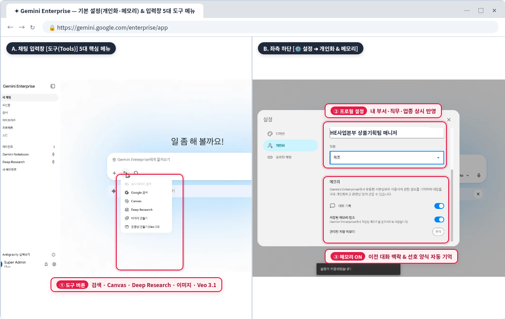

---

### 🔹 Step 1-5. 🧠 [멀티 모델 비교 실습] `Gemini 3.8 Flash` vs `Gemini 4 Argon` vs `Claude Opus 5.5` 직접 비교해보기

> <strong>🎯 핵심 포인트:</strong> Gemini Enterprise 채팅창 우측 하단의 모델 선택기(<strong>`Auto ⌄`</strong>)를 열면 <strong>`Gemini 4 Argon`</strong>, <strong>`Gemini 3.8 Flash`</strong>, <strong>`Claude Opus 5.5`</strong> 등 여러 최신 모델을 자유롭게 골라 쓸 수 있습니다.  
> 아래 직무별 샘플 프롬프트 중 원하는 주제를 골라 모델을 바꿔가며 실행해 보고, <strong>① 응답 속도, ② 표·목차 구조화 스타일, ③ 논리·수치 전개 방식, ④ 한국어 문장 톤앤매너</strong> 중 내 업무에 가장 잘 맞는 모델이 무엇인지 직접 비교해 보세요!

#### 1️⃣ 채팅창 우측 하단 모델 선택기(`Auto ⌄`)를 열어 모델 전환하기
1. 채팅 입력창 우측 하단의 <strong>`Auto ⌄`</strong> 버튼을 클릭해 모델 선택 메뉴를 엽니다.
2. 목록에서 <strong>`Gemini 4 Argon`</strong>, <strong>`Gemini 3.8 Flash`</strong>, <strong>`Claude Opus 5.5`</strong> 등을 번갈아 선택하며 아래 샘플 프롬프트를 입력해 봅니다.

👉 **화면 확인 포인트:** (우측 하단 `Auto ⌄` 클릭 ➔ `Gemini 4 Argon` · `Gemini 3.8 Flash` · `Claude Opus 5.5` 전환)
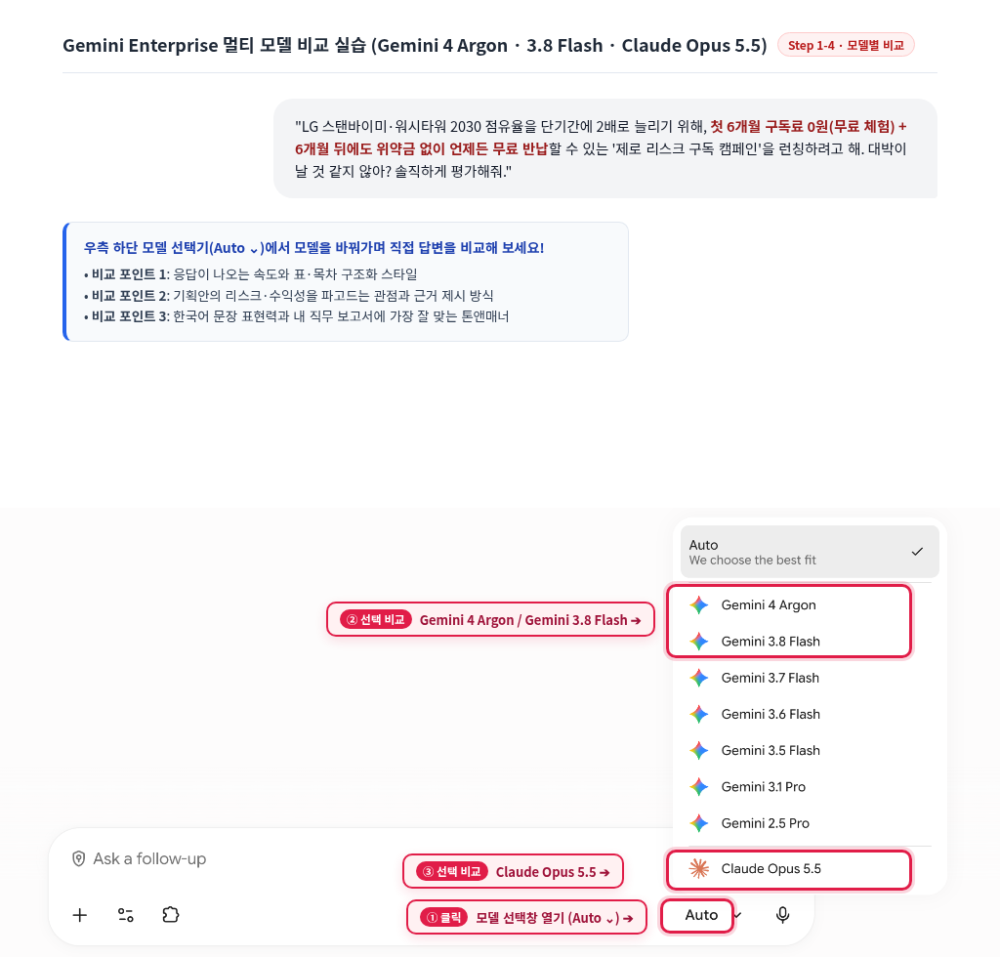

#### 2️⃣ [기본 비교 프롬프트 1~3] 한 줄로 모델 실력 차이 바로 비교하기

* **[샘플 1 — 💡 가전 구독(HaaS) '6개월 무료 체험 + 무위약금 반납' 기획안 빈틈 점검]**
```text
LG 워시타워 점유율을 늘리려고 '첫 6개월 구독료 0원 + 조건 없는 무료 반납' 캠페인을 기획했는데, 체리피커와 수익성 관점에서 숨은 함정과 대안을 짚어줘.
```

* **[샘플 2 — ⚖️ 북미 원가 8% 상승 vs 판매가 인상 시 15% 이탈 딜레마 해법]**
```text
북미 원가가 8% 올랐는데 판매가를 올리면 고객이 15% 이탈하는 상황이야. 마케팅비 추가 없이 수익성과 구독 전환을 동시에 잡을 가격 전략 3가지를 비교해줘.
```

* **[샘플 3 — 🎤 CFO 압박 질문 30초 방어 답변]**
```text
CFO가 "가전 구독은 당장 일시불 매출도 줄고 고객도 5년 총액이 더 비싼데 왜 회사와 고객 모두에게 이득이냐"고 물었을 때 30초 답변을 써줘.
```

#### 3️⃣ [추가 샘플 프롬프트 4~7] 직무별 의사결정 한 줄 프롬프트

<details class="file-list-details" open>
<summary><strong>🧪 직무별 한 줄 비교 프롬프트 4선 더 보기 (클릭하여 접기/펼치기)</strong></summary>

* **[샘플 4 — 📱 소형 주방가전 전 라인업 LCD·음성칩 일괄 탑재 타당성 검토]**
```text
내년도 출시되는 전자레인지·정수기·토스터기 전 모델에 LCD 화면과 음성인식 칩을 기본 탑재하고 가격을 15만 원씩 올리려는데, 예상 부작용과 현실적인 대안을 짚어줘.
```

* **[샘플 5 — 📉 경품 광고 '가입자 300% 급증' 착시 진단]**
```text
인스타 경품 광고로 가입자가 300% 늘었다고 다음 분기 검색 광고 예산을 전부 경품 광고에 몰아주려는데, 왜 위험한지 그로스 지표로 반박해줘.
```

* **[샘플 6 — ✍️ 워시타워 광고 카피(할인 강조 vs 구독 강조) 30대 맞벌이 관점 비교]**
```text
워시타워 광고 문구로 '20만 원 캐시백 할인 강조안'과 '월 3만 원대 퇴근 후 빨래 해방 구독 강조안' 중 30대 맞벌이 부부에게 어느 쪽이 더 잘 먹힐지 비교하고 결합 카피를 써줘.
```

* **[샘플 7 — 🤝 유럽 바이어 납품 단가 10% 인하 요구 방어 협상 메일]**
```text
유럽 대형 유통 바이어가 경쟁사 할인을 이유로 LG 히트펌프 납품 단가를 10% 깎아달라고 요구했을 때, 단가는 지키면서 계약을 성사시킬 역제안 협상 이메일을 써줘.
```

</details>

#### 4️⃣ 💡 [실무 활용 팁] 한 채팅창 안에서 모델 바꿔가며 교차 검토하기
첫 번째 모델로 초안을 만든 뒤, 같은 채팅창에서 우측 하단 모델만 바꿔 바로 약점을 점검시킬 수 있습니다:
```text
방금 위에서 작성된 초안에서 임원진이나 고객에게 반박당할 수 있는 약점 3가지를 찾아내고 보완 대안을 추가해줘.
```

---

### 🔹 Step 1-6. 🎨 [멀티모달 스튜디오] `Nano Banana` 캠페인 포스터 이미지 & `Veo 3.1` 8초 홍보 영상 생성하기

> <strong>🎯 핵심 포인트:</strong> 외부 디자인 툴 없이도 채팅창 <strong>`도구`</strong>에서 <strong>`이미지 만들기`(`Nano Banana`)</strong>와 <strong>`동영상 만들기`(`Veo 3.1`)</strong>를 선택해 기획안·마케팅 시안용 고화질 비주얼을 즉시 제작할 수 있습니다.

#### 1️⃣ `도구 ➔ 이미지 만들기`로 캠페인 포스터 생성 후 말로 부분 수정하기
1. 채팅 입력창 하단 **`도구 ➔ 이미지 만들기`**를 선택하고 아래 프롬프트를 입력합니다:

```text
유럽 밀라노 스타일의 모던한 거실과 주방에 놓인 차세대 LG OLED evo TV와 AI 워시타워 프리미엄 프로모션 화보 이미지를 16:9 비율로 그려줘.
```

2. 생성된 이미지를 보고 *"배경 조명을 따뜻한 저녁 노을 톤으로 바꾸고 우측 하단에 'LG AI Home' 문구를 깔끔하게 넣어줘"*처럼 **후속 대화로 원하는 부분만 바로 수정**합니다.

#### 2️⃣ `도구 ➔ 동영상 만들기(Veo 3.1)`로 8초 시네마틱 제품 영상 만들기
* 채팅 입력창 하단 **`도구 ➔ 동영상 만들기(Veo 3.1)`**를 선택하고 아래 한 줄 프롬프트를 입력하면 카메라 무빙과 배경음이 포함된 **8초 고화질 MP4 영상**이 생성됩니다:

```text
햇살이 들어오는 미니멀한 화이트 세탁실에서 LG 워시타워의 원바디 다이얼이 부드럽게 빛나며 세탁이 시작되는 8초 시네마틱 광고 영상. 부드러운 카메라 클로즈업과 잔잔한 모던 배경음.
```

👉 **화면 확인 포인트:** (`① [도구 ➔ 이미지 만들기] 생성 및 대화형 수정` & `② [도구 ➔ 동영상 만들기(Veo 3.1)] 8초 MP4 영상 생성`)
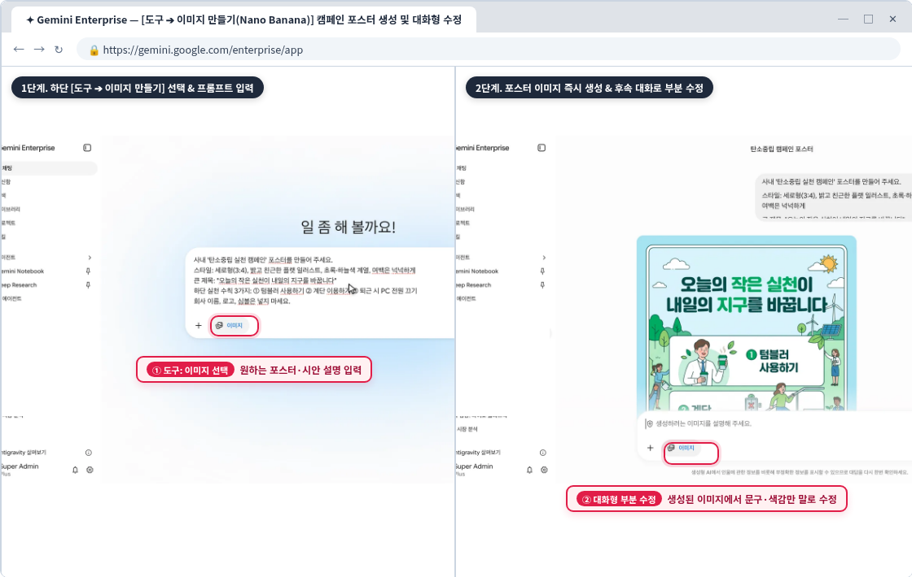

---

### 🔥 [Part 1 심화 미션 · OPTIONAL] 내 부서 맞춤 보고서 양식 & 나만의 `.md` 스킬 커스텀 개조하기

> <strong>💡 실무 확장 미션 (현업 응용)</strong>  
> 기본 보고서와 스킬 설치를 마쳤다면, 실제 내 부서 현업 보고서에 바로 적용할 수 있도록 아래 2가지 커스텀 미션을 직접 수행해 보세요.

1. <strong>미션 A (`Knowledge` 양식 개조)</strong>: `01_GE_Workflow_lg_weekly_report_template.txt` 파일의 2번 표 컬럼에 <strong>`[당사 대응 우선순위 ( 상 / 중 / 하 )]`</strong>와 <strong>`[예상 소요 예산/일정]`</strong> 컬럼을 직접 추가해 재업로드한 뒤 결과가 어떻게 바뀌는지 비교해 보세요.
2. <strong>미션 B (나만의 `.md` 스킬 직접 만들어 업로드하기)</strong>: `01_GE_Skill_lg_executive_briefing_SKILL.md` 파일을 메모장으로 열어 `name: lg-cfo-risk-review`로 바꾸고, 지침에 <strong>"CFO(재무 최고책임자) 관점에서 수익성·원가·관세 리스크를 최우선으로 비판적으로 서술할 것"</strong>을 추가해 두 번째 스킬로 업로드(`Upload skill`)한 뒤 `/lg-cfo-risk-review`로 호출해 보세요!

---

# ⚡ [1부 · 크롬 브라우저] Part 2. GE Workflow & HITL 사람 승인 자동화
### 🔹 Step 2-0. [필수] 실습 시작 전 Gmail 연동(Authorize) 1회 사전 승인하기

> <strong>⚠️ Workflow 실행 전 필수 점검:</strong>  
> 이번 파트에서는 워크플로우 마지막 단계에서 사람이 최종 승인한 보고서를 <strong>내 Gmail 임시보관함(`Drafts`)에 자동으로 생성</strong>합니다.  
> 노드를 다 만든 후 `Test` 실행 중에 권한 팝업 차단이나 연동 오류가 발생하지 않도록, <strong>본격적인 워크플로우 조립 전 Gmail 앱 권한(OAuth)을 미리 1회 연동(Authorize)</strong>해 둡니다.

1. 크롬에서 **Gemini Enterprise** 좌측 메뉴 **`New Agent` ➔ `Workflow`** 진입 후 우측 패널의 **`연결된 앱` (Connected apps)** 확인
2. 목록에서 **`Gmail`** 우측의 **`작업 사용 설정` (또는 `[Connect]`)** 링크를 클릭합니다.
3. 화면에 뜨는 **`로그인 - Google 계정 (계정을 선택하세요. Gemini Enterprise(으)로 이동)`** 팝업창에서 내 계정을 선택하고 **`Allow`(허용)**를 눌러 권한을 1회 승인합니다.
4. 사전 연동이 완료되었다면 아래 **Step 2-1**로 이동하여 5단계 자동화 파이프라인을 본격적으로 조립합니다!

👉 **사전 권한 승인 화면:** (`우측 연결된 앱 > Gmail [작업 사용 설정] 클릭 ➔ Google 계정 로그인 팝업 Allow 승인`)
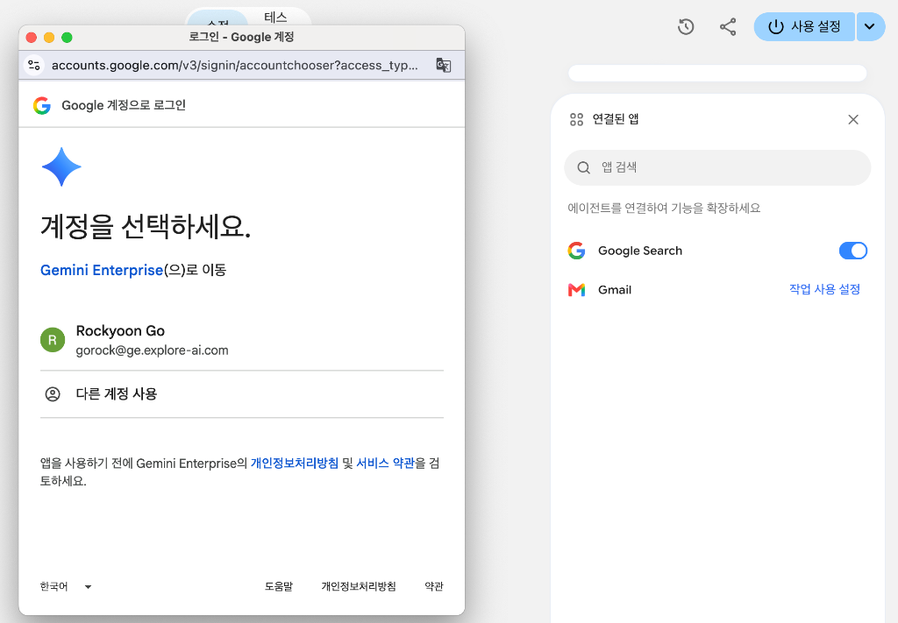

---

### 🔹 Step 2-1. 트렌드 조사 + 양식 포맷팅(`.md` 첨부) + 사람 승인(`Approval`)을 Workflow로 연결하기

> <strong>🎯 핵심 포인트:</strong> <strong>[뉴스 검색 ➔ 보고서 양식 변환 ➔ 사람 승인 ➔ 지메일 저장]</strong>을 한 번에 이어주는 자동화 파이프라인입니다. 앞 단계 결과를 빠짐없이 넘겨주기 위해 출력 변수(`content`) 하나로 연결합니다.

* **전체 연결 흐름 (5단계 노드)**:
  - <strong>`Manual` (시작 트리거)</strong> ➔ <strong>`Gemini Agent` (트렌드 뉴스 수집 · `content` 출력)</strong> ➔ <strong>`Gemini Agent 1` (`01_GE_Workflow_lg_weekly_report_template.md` 첨부 양식 포맷팅 · `content` 출력)</strong> ➔ <strong>`Approval` (사람의 개입 HITL)</strong> ➔ <strong>`Gemini Agent 2` (Gmail 드래프트 생성)</strong>

---

#### 0️⃣ 워크플로우 생성 시작 — `Build manually` (수동 빌더 진입)
1. 좌측 메뉴에서 <strong>`New Agent` ➔ `Workflow`</strong>를 클릭합니다.
2. **"Let's build your workflow"** 시작 화면 우측 하단의 <strong>`🔧 Build manually`</strong> 버튼을 클릭해 캔버스 편집기를 엽니다.

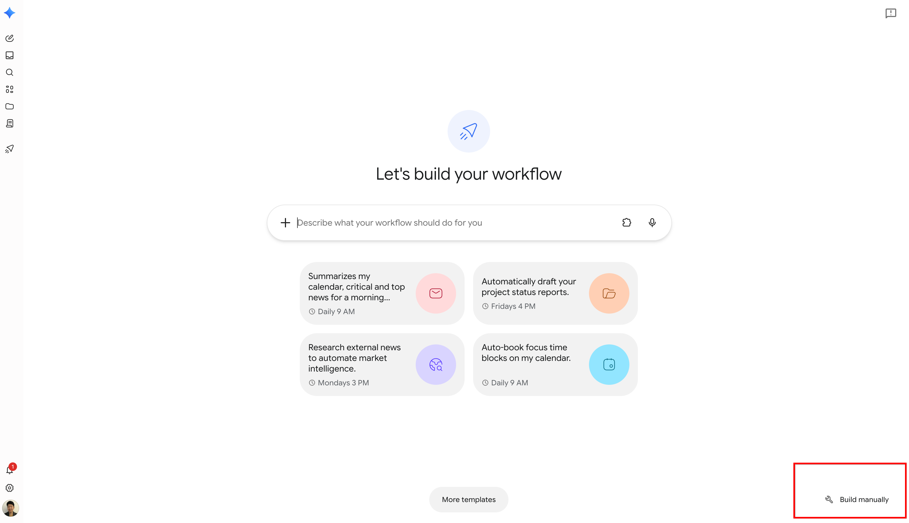

---

#### ① `1. Manual` — 시작 트리거 노드 확인
* **루트 트리거 확인**: 캔버스 상단에 기본 생성된 <strong>`1 Manual`</strong> 노드를 클릭하고 우측 패널의 `Trigger type`이 <strong>`Manual`</strong>(수동 실행)로 되어 있는지 확인합니다. *(별도의 `Input fields`는 추가하지 않습니다.)*

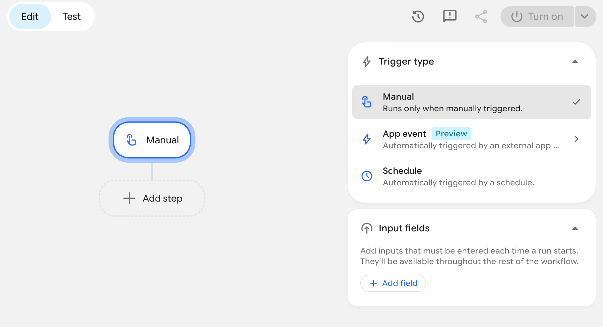

---

#### ② `2. Gemini Agent` — 1단계: 트렌드 뉴스 수집 & `Structured output`(`content`) 설정
1. **노드 추가 및 프롬프트 입력**: `Manual` 노드 아래 <strong>`+ Add step`</strong> 클릭 ➔ 첫 번째 <strong>`Gemini Agent`</strong>를 추가합니다. 우측 패널 <strong>`Connected apps`</strong>에 <strong>`Google Search` (G 아이콘)</strong>가 켜져 있는지 확인하고, <strong>`Instructions`</strong> 칸에 아래 프롬프트를 입력합니다:

```text
최근 1개월간 LG전자 핵심 AI 가전(OLED evo, 워시타워, HVAC) 및 경쟁사 시장 트렌드 뉴스를 조사해서 핵심 요약, 주요 동향·수치, 출처([매체명, 날짜])를 핵심 위주로 간결하게 정리해줘.
```

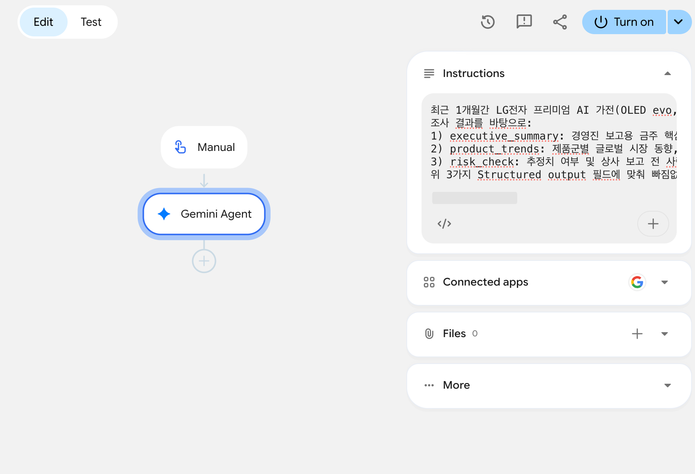

2. **`More` ➔ `Output`을 `Structured output`으로 변경**: 우측 패널 맨 아래 <strong>`More`</strong>를 클릭해 펼친 뒤, <strong>`Output`</strong> 드롭다운(`Plain text`)을 눌러 <strong>`Structured output` (정형화된 서식 출력)</strong>을 선택합니다.

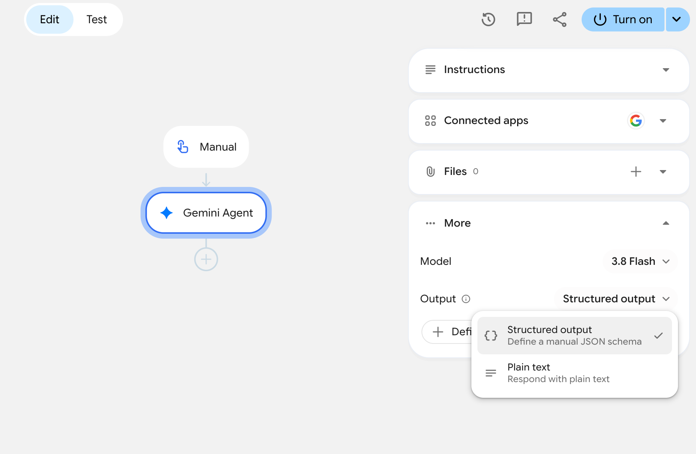

3. **`Output Format`에 `content` (`Text`) 단일 변수 등록**: <strong>`+ Define output schema` (출력 변수 정의)</strong>를 클릭해 팝업창을 열고, 필드명 <strong>`content`</strong> (타입: <strong>`Text`</strong>)를 입력한 뒤 우측 하단 <strong>`Apply Schema`</strong>를 클릭합니다. (설정이 완료되면 우측 패널 Output 아래에 `= content` 칩이 표시됩니다.)

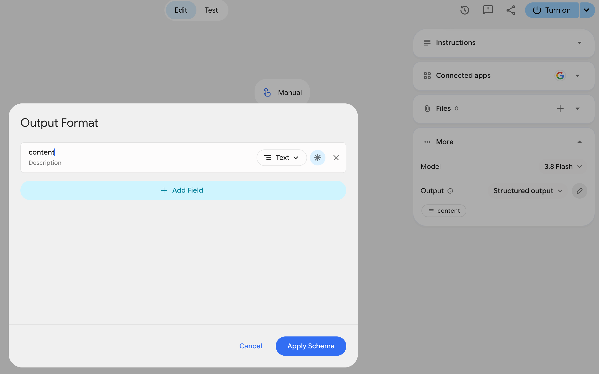

---

#### ③ `3. Gemini Agent 1` — 2단계: `01_GE_Workflow_lg_weekly_report_template.md` 양식 첨부 & `content` 변수 전달
1. **이전 단계 `content` 변수 불러오기 (`+` ➔ `{} Variables`)**: 첫 번째 `Gemini Agent` 아래 <strong>`+ Add step`</strong>을 눌러 두 번째 에이전트(<strong>`Gemini Agent 1`</strong>)를 추가합니다. 우측 <strong>`Instructions`</strong> 입력창 우측 하단의 <strong>`+` 아이콘</strong>을 클릭하고 <strong>`{} Variables`</strong>를 선택합니다.

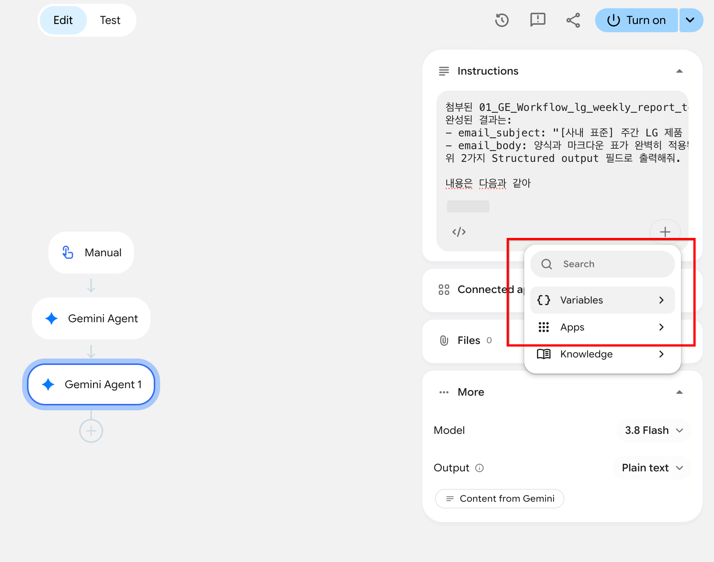

2. **`2 ✨ Gemini Agent: content` 클릭 및 지시문 작성**: 변수 목록에서 앞 단계의 출력 변수인 <strong>`2 ✨ Gemini Agent: content` (`Text`)</strong>를 클릭해 삽입하고, 아래와 같이 첨부된 `.md` 템플릿 파일로 변환하는 프롬프트를 작성합니다:

```text
Gemini Agent: content
첨부된 사내 표준 보고서 양식(01_GE_Workflow_lg_weekly_report_template.md)에 맞춰 위 트렌드 조사 내용을 주간 LG 제품 시장 트렌드 보고서 전문으로 포맷팅해줘.
```

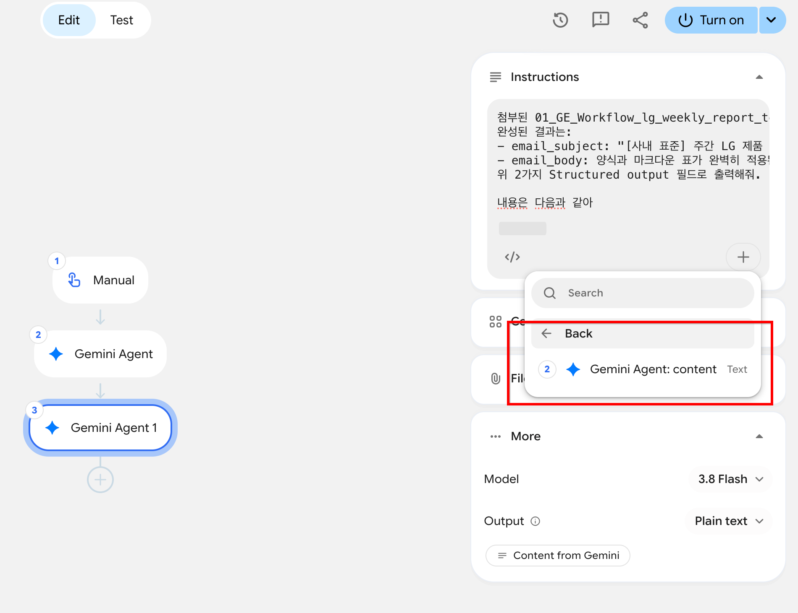

3. **`Files`에 사내 표준 양식 마크다운 파일(`.md`) 첨부**: 우측 패널 중앙의 <strong>`Files 0`</strong> 옆 <strong>`+` 버튼 (`Ground the agent in your data`)</strong>을 클릭하여 실습 폴더의 마크다운 템플릿 파일 **[`01_GE_Workflow_lg_weekly_report_template.md`](./files/01_GE_Workflow_lg_weekly_report_template.md)**를 첨부파일로 넣습니다.

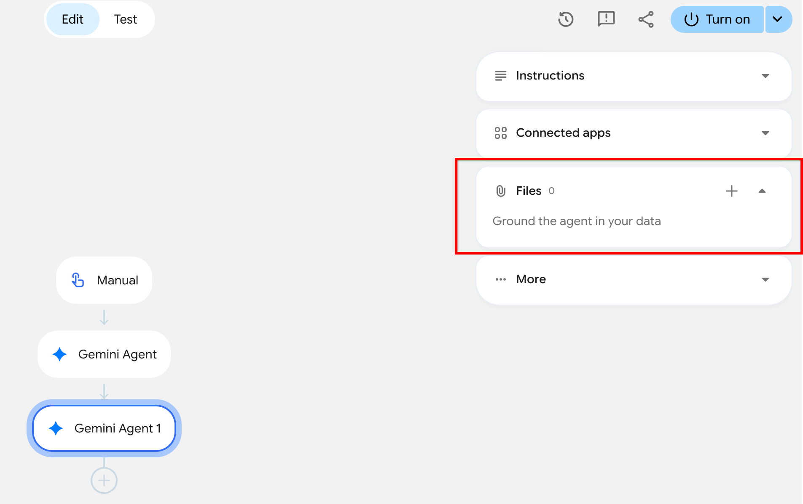

4. **`Files 1` 첨부 확인 & `Structured output` (`= content`) 설정**: 템플릿 `.md` 파일이 첨부되어 <strong>`Files 1`</strong>로 바뀐 것을 확인하고, 1단계와 동일하게 하단 <strong>`More` ➔ `Output` ➔ `Structured output`</strong>을 선택해 <strong>`content` (`Text`)</strong> 단일 변수를 등록합니다.

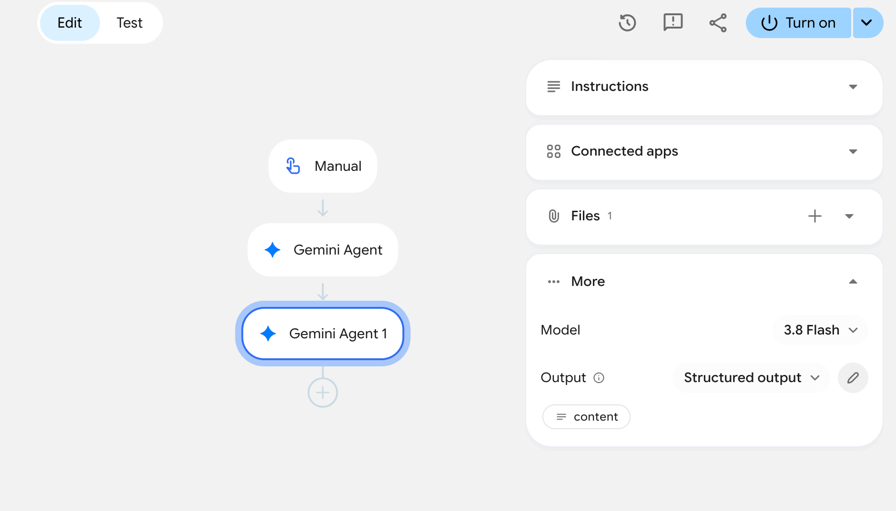

---

#### ④ `4. Approval` — 3단계: `HITL (Human-in-the-Loop)` 사람 검토·승인 게이트
1. **`Human in the Loop` ➔ `Approval` 노드 추가**: `Gemini Agent 1` 아래 <strong>`+ Add step`</strong>을 클릭한 뒤, 우측 패널에서 <strong>`Human in the Loop`</strong> 카테고리를 펼치고 <strong>`Approval`</strong>을 선택합니다. (캔버스에 초록색 `Approved` / 회색 `Rejected` 갈림길이 자동 생성됩니다.)

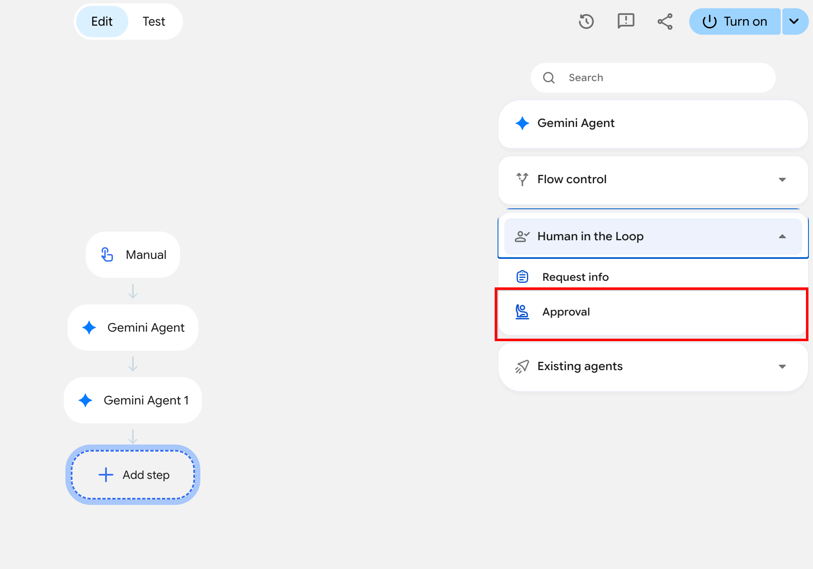

2. **`Approval` ➔ `Message`에 `3 ✨ Gemini Agent 1: content` 변수 삽입**: 우측 패널 <strong>`Message`</strong> 입력칸 우측 하단의 <strong>`+` 아이콘 ➔ `{} Variables`</strong>를 누르고, 포맷팅이 완료된 보고서 변수인 <strong>`3 ✨ Gemini Agent 1: content` (`Text`)</strong>를 클릭합니다.

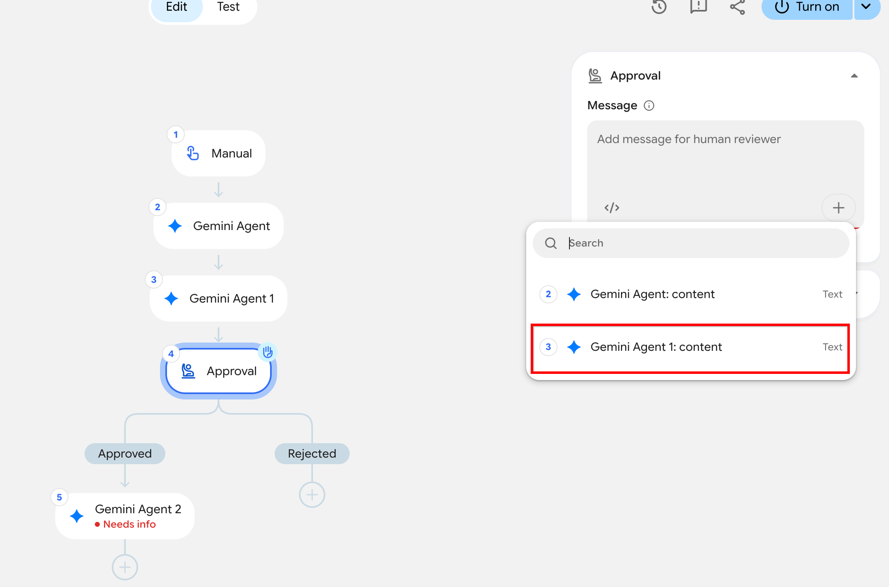

3. **결재 요청 문구 작성**: 삽입된 <strong>`Gemini Agent 1: content`</strong> 변수 아래에 아래와 같이 결재 확인 문구를 입력합니다:

```text
Gemini Agent 1: content
결재하시겠습니까?
```

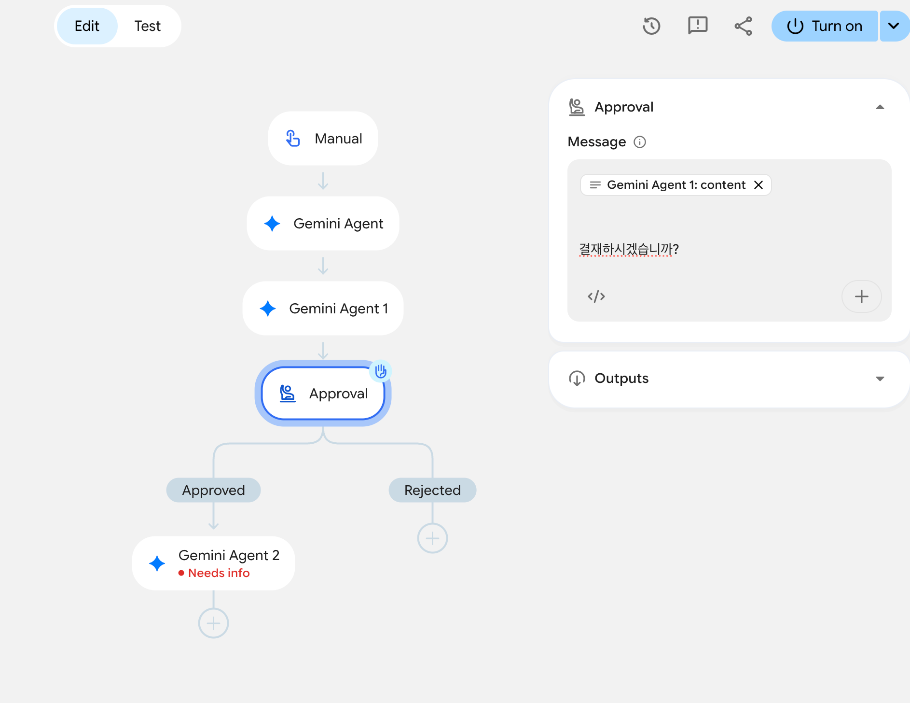

---

#### ⑤ `5. Gemini Agent 2` — 4단계: 승인(`Approved`) 시 내 Gmail 임시보관함 드래프트 생성
1. **`Approved` 분기 아래에 `Gemini Agent 2` 추가 & `content` 변수 삽입**: 캔버스의 초록색 <strong>`Approved`</strong> 경로 아래 <strong>`+` 버튼</strong>을 눌러 <strong>`Gemini Agent 2`</strong>를 추가합니다. 우측 <strong>`Instructions`</strong> 칸에서 <strong>`+` ➔ `{} Variables` ➔ `3 ✨ Gemini Agent 1: content` (`Text`)</strong>를 클릭해 승인된 보고서 본문을 불러옵니다.

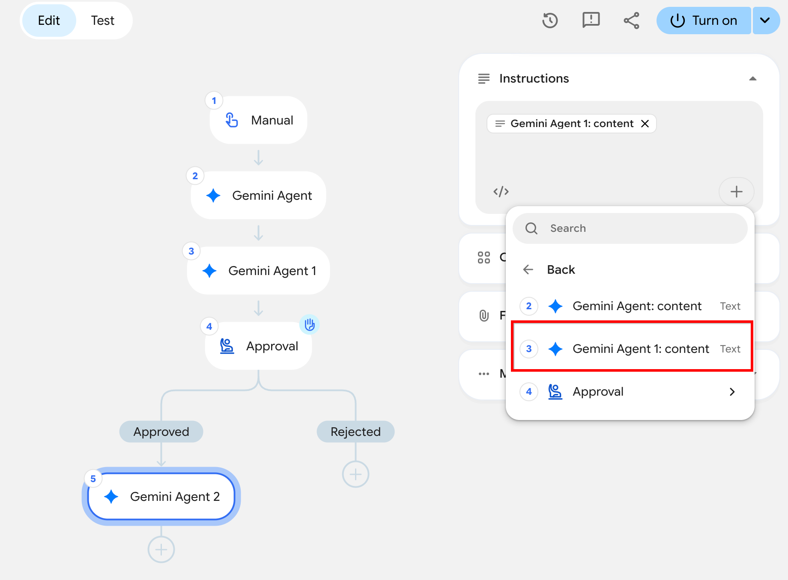

2. **`Connected apps`에서 `Gmail` 세부 권한 토글 확인**: 우측 패널의 **`연결된 앱`**에서 `Gmail`을 클릭해 펼친 뒤, 메일 초안 생성을 위해 **`데이터 추가 또는 업데이트하기`** 스위치가 **ON (파란색)**으로 켜져 있는지 확인합니다. *(Step 2-0에서 이미 사전에 `작업 사용 설정` ➔ `Allow` 승인을 마쳤으므로 바로 스위치를 켤 수 있습니다.)*

👉 **화면 확인 포인트:** (`연결된 앱 ➔ Gmail 펼치기 ➔ '데이터 추가 또는 업데이트하기' 토글 ON 확인`)
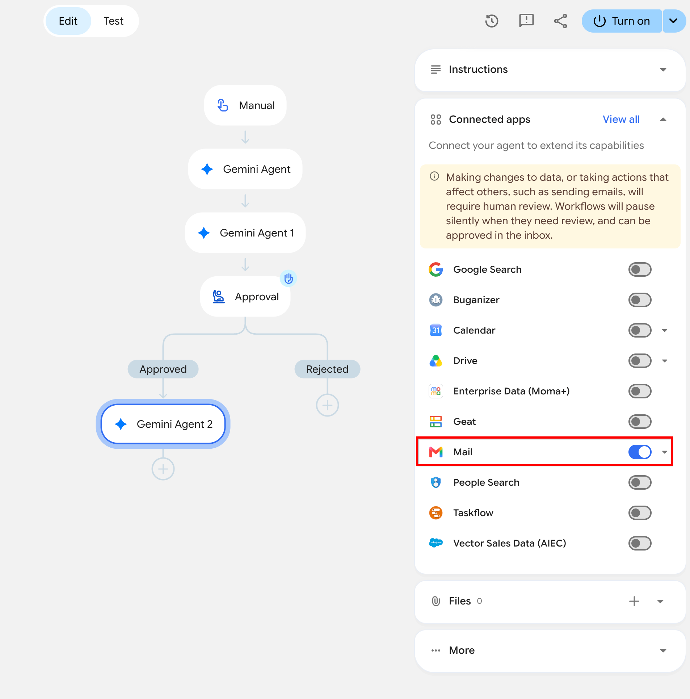

3. **Gmail 드래프트 생성 프롬프트 완성**: `Instructions`의 <strong>`Gemini Agent 1: content`</strong> 변수 뒤에 아래 지시문을 입력합니다 (최종 단계이므로 `Output`은 기본 `Plain text` 그대로 둡니다):

```text
Gemini Agent 1: content
해당 내용으로 메일 드래프트를 써놔
```

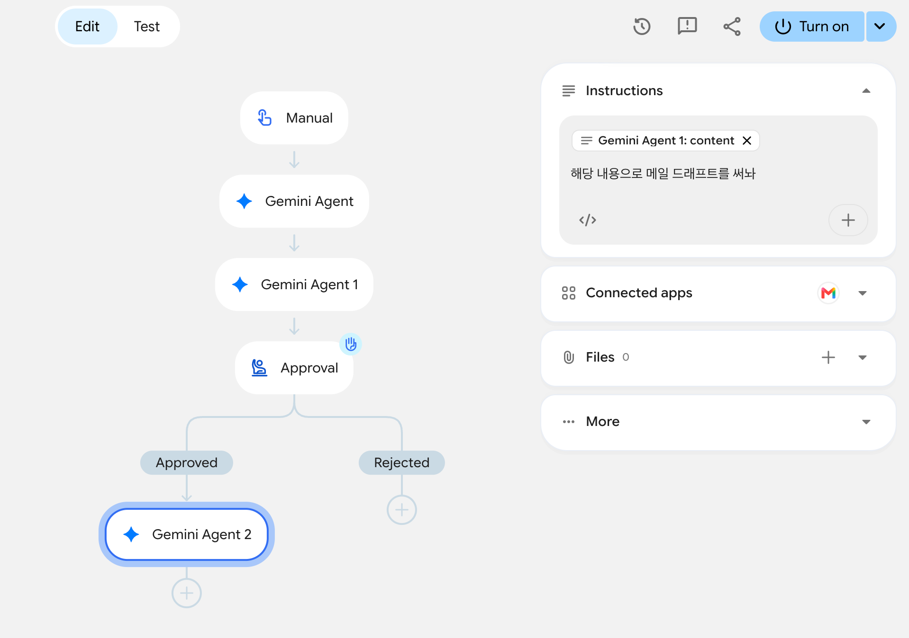

---

#### ⑥ 워크플로우 활성화(`Turn on`) 및 테스트(`Test`) 실행
* 5개 노드(`Manual` ➔ `Gemini Agent` ➔ `Gemini Agent 1` ➔ `Approval` ➔ `Gemini Agent 2`) 설정이 모두 끝났다면, 화면 우측 상단의 파란색 <strong>`Turn on`</strong> 버튼을 눌러 워크플로우를 활성화하고 좌측 상단의 <strong>`Test`</strong> 탭을 눌러 실행을 시작합니다!

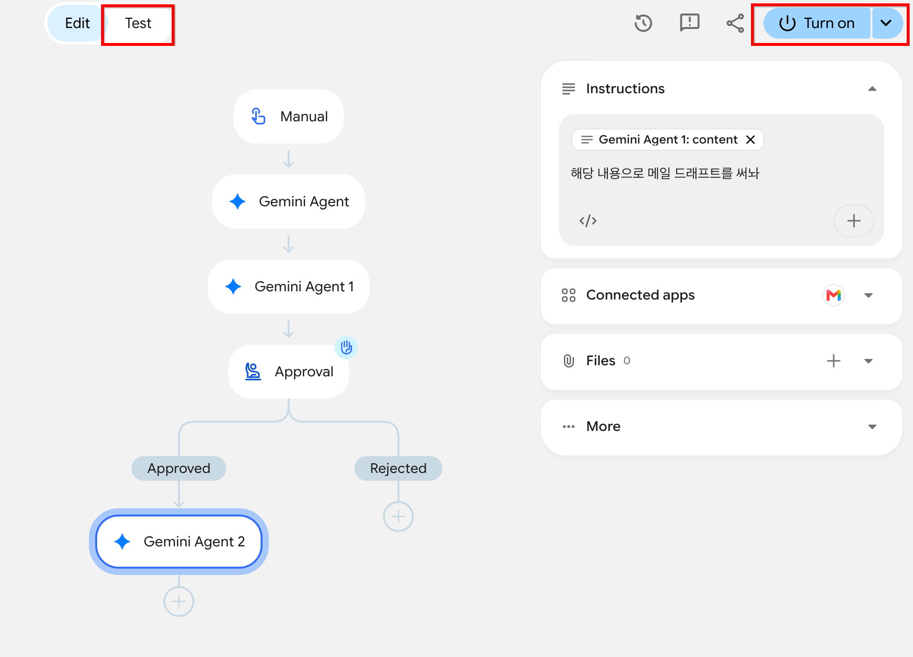

---

### 🔹 Step 2-2. `HITL (Human-in-the-Loop)` — 상사 메일 포워딩 전 사람이 검토·승인하기

> <strong>🎯 핵심 포인트:</strong> AI가 틀린 내용을 마음대로 보내지 못하도록 잠시 멈추고, <strong>사람이 눈으로 확인해 `[Approved]`(승인)를 눌렀을 때만</strong> 지메일에 저장되게 합니다.

1. 상단 <strong>`Test`</strong> 탭에서 워크플로우를 실행하면, 보고서 초안 생성 직후 <strong>`Approval`</strong> 단계에서 자동 대기 상태가 됩니다.
2. 생성된 보고서의 수치 출처와 내용을 검토한 뒤 <strong>`[Approved]`</strong>를 클릭합니다.
3. 우측 패널에 초록색 체크와 함께 <strong>`The AI trends report workflow has completed, and a Gmail draft has been successfully created for you.`</strong> 완료 메시지가 뜨는지 확인합니다.

👉 **화면 확인 포인트:** (`Approval` 통과 후 Gmail Draft 생성 완료 메시지)
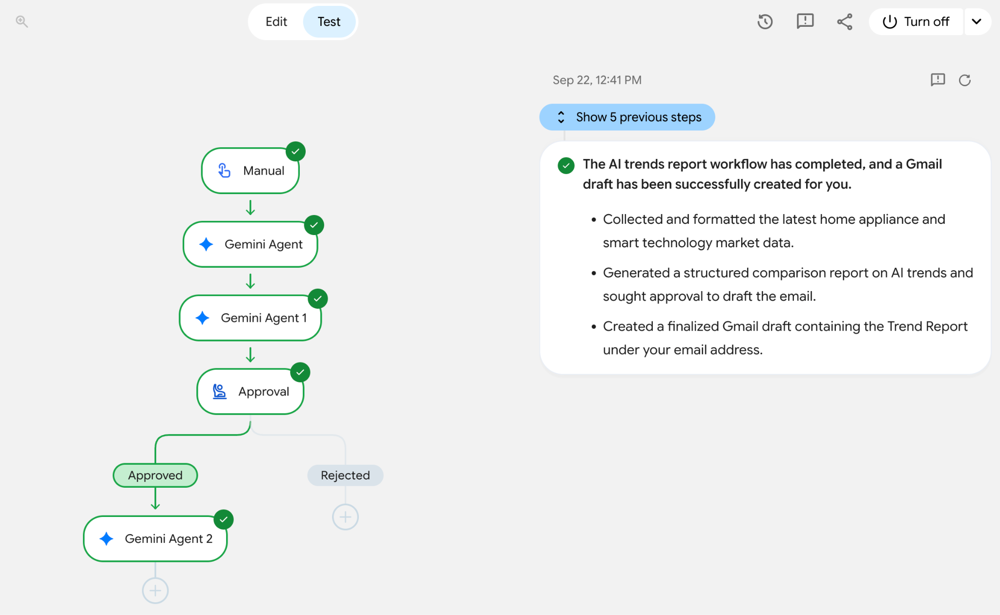

---

### 🔹 Step 2-3. 내 Gmail `[임시보관함(Drafts)]`에 생성된 사내 표준 보고 메일 최종 확인하기

1. 내 <strong>Gmail</strong>을 열고 좌측 <strong>`임시보관함(Drafts)`</strong> 탭을 클릭합니다.
2. 방금 워크플로우가 만들어 놓은 <strong>`[사내 표준] 주간 LG 제품 시장 트렌드 보고서`</strong> 메일을 엽니다.
3. 상단 `📌 [Executive Summary] 금주 핵심 요약 (3줄)`과 하단 `📊 제품군별 글로벌 시장 트렌드 비교표` 서식이 깔끔하게 들어왔는지 확인합니다.

👉 **화면 확인 포인트:** (내 Gmail 임시보관함에 생성된 `[사내 표준] 주간 LG 제품 시장 트렌드 보고서`)
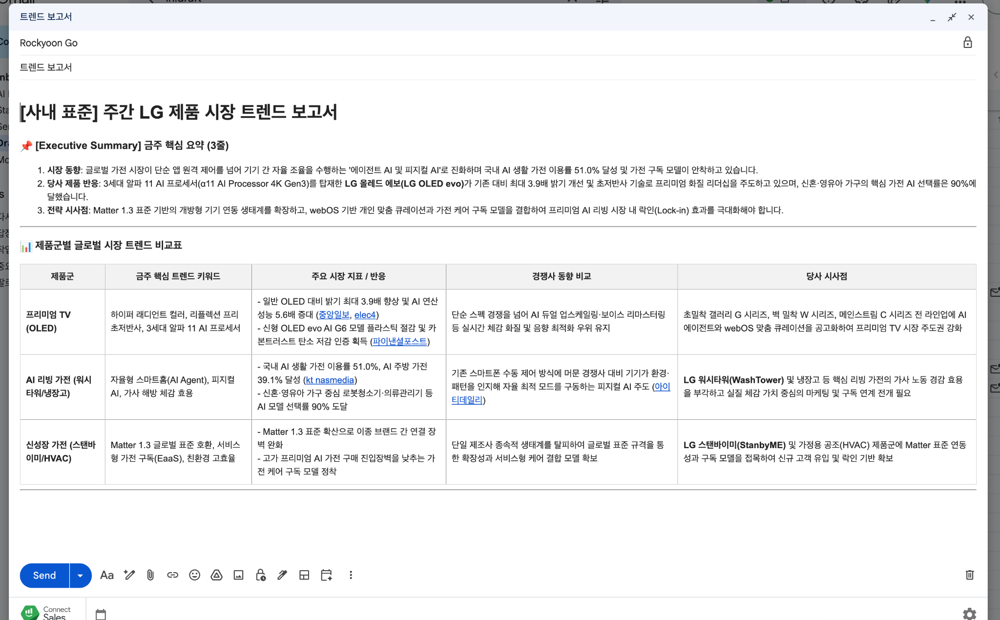

---

### 🔹 Step 2-4. 🤖 [노코드 `채팅 에이전트` 빌더] 사내 규정 도우미 봇 + `하위 에이전트` 연결 & `@멘션`으로 소환하기

> <strong>🎯 `Workflow` vs `채팅 에이전트(Chat Agent)` 무엇이 다른가요?</strong>
> * <strong>`Workflow` (Step 2-1)</strong>: 정해진 순서(`검색 ➔ 양식 변환 ➔ 승인 ➔ 메일 저장`)대로 끝까지 자동 실행되는 <strong>단방향 파이프라인</strong>
> * <strong>`채팅 에이전트(Chat Agent)`</strong>: 사내 규정집·매뉴얼 파일을 넣어두고 임직원이 궁금한 점을 계속 물어보는 <strong>대화형 전용 챗봇</strong> (일반 채팅창에서 <strong>`@에이전트이름`</strong>으로 언제든 소환 가능!)

#### 1️⃣ `새 에이전트 ➔ 채팅 에이전트`에서 말로 에이전트 + `하위 에이전트(Sub-agent)` 만들기
1. 좌측 메뉴 **`+ 새 에이전트` ➔ `채팅 에이전트`**를 클릭합니다.
2. 시작 화면 하단 입력창에 `+` 버튼으로 사내 규정/가이드 파일을 첨부하고 아래와 같이 자연어로 설명합니다:

```text
LG전자 임직원의 해외출장·경비 규정 질문에 답하는 '출장 경비 규정 도우미' 에이전트를 만들어줘. 귀국일을 입력받으면 정산 마감일(7영업일 이내)을 자동 계산해주는 '정산 기한 계산 도우미' 하위 에이전트도 아래에 연결해줘.
```

3. 우측 캔버스에 **주 에이전트(`출장 경비 규정 도우미`)**와 **하위 에이전트(`정산 기한 계산 도우미`)** 2단 노드가 자동 생성되면, 상단 **`미리보기`** 탭에서 답변을 테스트한 뒤 파란색 **`생성`(또는 `업데이트`)** 버튼을 클릭합니다.

#### 2️⃣ 일반 채팅창 어느 곳에서나 `@멘션`으로 내 에이전트 바로 불러 쓰기
* 에이전트를 한 번 만들어 두면 굳이 에이전트 메뉴로 들어갈 필요 없이, **홈 채팅창에서 `@`를 타이핑(예: `@출장 경비 규정 도우미`)**해 내가 만든 전문 에이전트를 즉시 소환해 질문할 수 있습니다!

👉 **화면 확인 포인트:** (`① 주 에이전트 + 하위 에이전트 2단 노드 연결` & `② 홈 채팅창에서 @멘션으로 즉시 호출`)
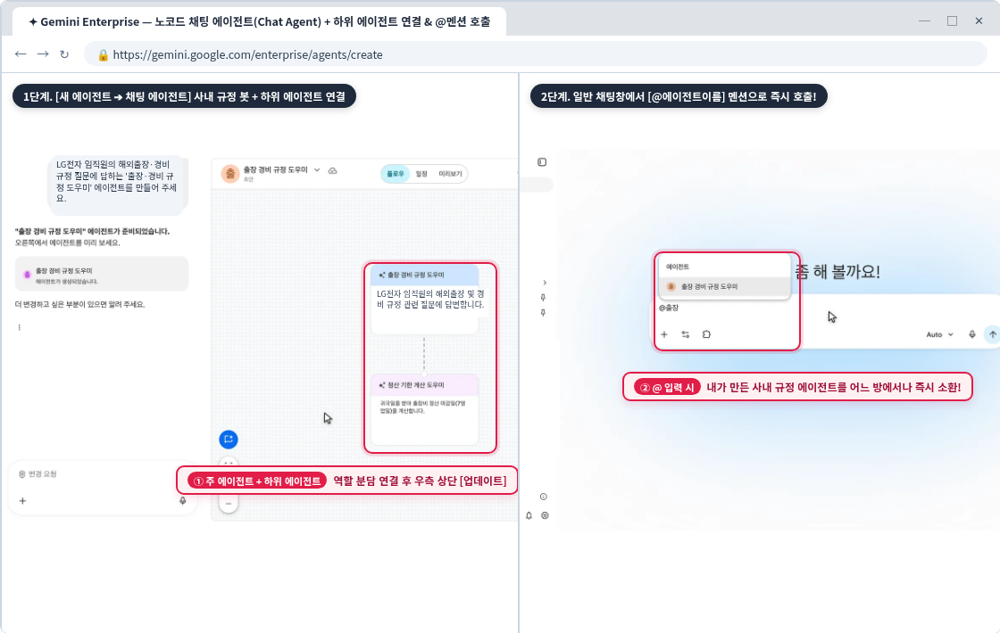

---

### 🔹 Step 2-5. 💬 [자연어 `Workflow` & 정기 스케줄] 말 한마디로 매주 월요일 자동 실행되는 스케줄 워크플로 만들기

> <strong>🎯 핵심 포인트:</strong> Step 2-1처럼 `Build manually`로 노드를 하나씩 직접 조립할 수도 있지만, <strong>왼쪽 대화창에 하고 싶은 일을 말로 설명하면 AI가 알아서 정기 스케줄(`Schedule` 트리거)과 에이전트 노드 체인을 자동으로 조립·수정(`diff`)</strong>해 줍니다!

#### 1️⃣ `새 에이전트 ➔ 워크플로` 시작 화면에서 자연어로 스케줄 파이프라인 지시하기
1. 좌측 메뉴 **`+ 새 에이전트` ➔ `워크플로`**를 클릭합니다.
2. `Build manually`를 누르는 대신, 화면 중앙 입력창에 아래 문장을 그대로 복사해 입력합니다:

```text
매주 월요일 오전 8시에 자동 실행되는 '주간 가전·HVAC 시장 동향 브리핑' 워크플로를 만들어줘.
1단계: 구글 검색으로 최근 1주일간 프리미엄 TV(OLED evo), AI 워시타워, HVAC 히트펌프 뉴스 수집
2단계: LG전자 사업 관점의 영향도와 시사점 도출
3단계: 핵심 요약 3줄과 이슈 정리 표로 주간 브리핑 문서 작성
```

#### 2️⃣ 자동 조립된 `Mon at 8:00 AM` 스케줄 트리거 확인 & 대화로 단계 수정 후 `사용 설정` 켜기
1. 우측 캔버스에 **`🕒 Mon at 8:00 AM` (정기 스케줄 트리거) ➔ `시장 뉴스 검색 에이전트` ➔ `영향도 분석 에이전트` ➔ `주간 브리핑 작성 에이전트`** 노드가 한 번에 자동 배치됩니다!
2. 좌측 하단 **`무엇을 바꾸고 싶으신가요?`** 채팅창에 *"마지막 단계 뒤에 사람 승인(Approval) 노드를 추가해줘"*처럼 말로 수정(`diff` 확인 가능)한 뒤, 우측 상단 파란색 **`⚡ 사용 설정`** 버튼을 누르면 매주 월요일 아침마다 자동으로 워크플로우가 실행됩니다.

👉 **화면 확인 포인트:** (`① 좌측 자연어 지시창으로 노드 자동 생성·수정` ➔ `② Mon at 8:00 AM 정기 스케줄 트리거` ➔ `③ 우측 상단 [사용 설정] ON`)
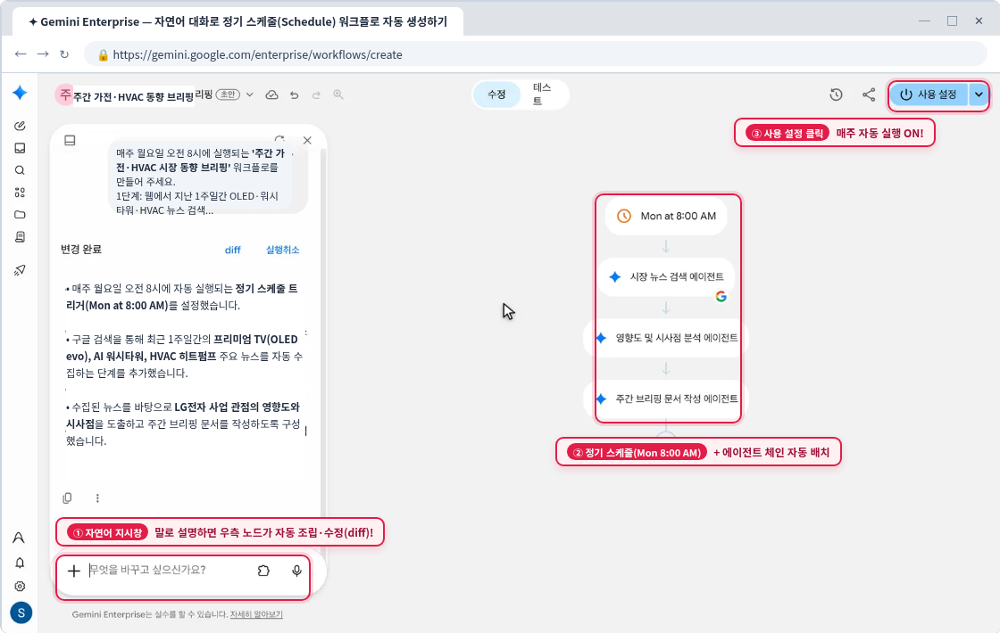

---

### 🔥 [Part 2 심화 미션 · OPTIONAL] `Rejected` (반려) 분기 처리 & 다중 수신자 조건부 라우팅

> <strong>💡 실무 확장 미션 (조건부 분기 심화)</strong>  
> 기본 승인(`Approved`) 흐름을 확인했다면, 실제 현업 자동화에서 자주 쓰이는 반려(`Rejected`) 루프와 다중 수신자 분기를 직접 구성해 보세요.

1. <strong>미션 A (`Rejected` 반려 루프 테스트)</strong>: `Test` 실행 시 일부러 <strong>`[Rejected]`(반려)</strong> 버튼을 눌러보고, 반려 시 <strong>"출처가 불명확한 수치를 제외하고 재작성해 다시 승인을 요청하라"</strong>는 피드백 노드를 `Rejected` 갈림길 아래에 추가해 보세요.
2. <strong>미션 B (`If / else` 조건 분기: 임원용 3줄 요약 vs 실무진용 상세본 생성)</strong>: `Approval` 통과(`Approved`) 후 `+` 버튼을 눌러 <strong>`Flow control ➔ If / else`</strong> 노드를 추가하고 특정 조건(예: 보고서 본문에 `"긴급"`·`"리스크"` 등 특정 키워드 포함 여부 또는 분량 조건)을 걸어 분기해 보세요. 조건 충족(`If`) 시에는 <strong>팀장님용 핵심 3줄 요약 메일 초안</strong>, 그 외(`Else`)에는 <strong>팀원 공유용 전체 비교표 메일 초안</strong>이 각각 Gmail 임시보관함에 생성되도록 확장해 봅니다.

---

# 💻 [2부 · 데스크톱 앱] Part 3. Antigravity 입문 — 4대 루프 & LG 브랜드 웹 슬라이드
### 🔹 Step 3-0. [필수] 실습 시작 전 `Use Business Account` 로그인 & `Settings (⚙️)` 권한 점검하기

> <strong>⚠️ Antigravity 첫 실행 시 로그인 방식과 기본 권한 설정을 먼저 확인하세요!</strong>  
> 처음 로그인할 때는 반드시 **`Use Business Account` ➔ `Continue with Google Cloud`** 순서로 진입하고, 이어서 좌측 하단 <strong>`⚙️ Settings` ➔ `General`</strong>의 설정값을 확인합니다.

#### 0️⃣ [최초 로그인 시] 회색 버튼 `Use Business Account` ➔ 파란색 `Continue with Google Cloud` 클릭!
1. Antigravity 첫 로그인 화면에서 파란색 일반 버튼이 아닌 **아래쪽 회색 버튼 `Use Business Account`**를 클릭합니다.
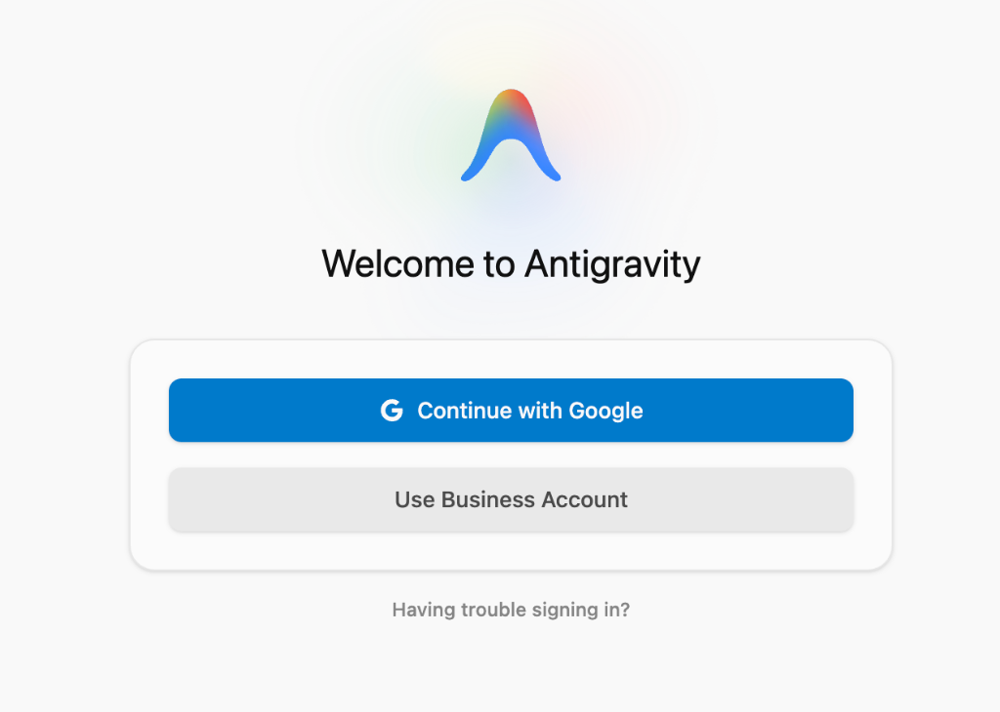

2. 다음 화면에서 하단 SSO(`Use Advanced SSO Config`)를 누르지 말고, **파란색 `☁️ Continue with Google Cloud` 버튼**을 클릭해 실습 계정으로 로그인합니다.
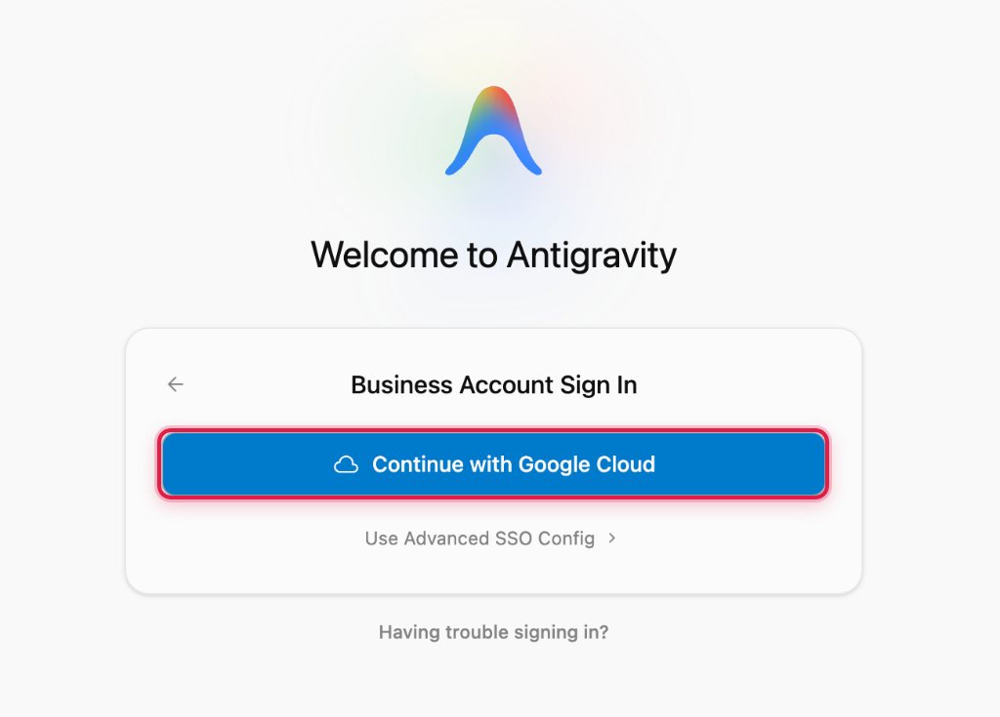

#### 1️⃣ `Settings ➔ General` 상단 확인: `Permission Preset` & `Artifact Review Policy`
* 좌측 하단 <strong>`⚙️ Settings`</strong> 클릭 ➔ <strong>`General`</strong> 탭에서 <strong>`Permission Preset: Default`</strong> (또는 `Turbo`), <strong>`Artifact Review Policy: Always Ask`</strong> 상태를 확인합니다. *(참고: `Tool Permissions`와 `Network Access Rules` 우측의 `Open`은 세부 규칙 편집 창을 여는 버튼입니다.)*

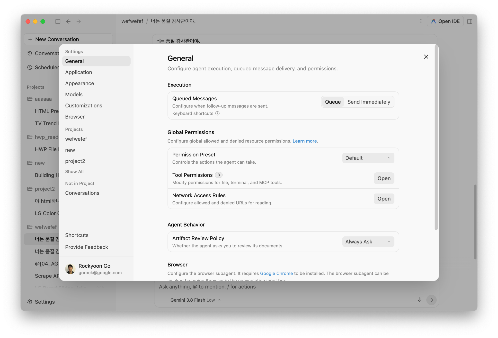

#### 2️⃣ `Settings ➔ General` 아래로 스크롤: `Browser Javascript Execution Policy` 확인
* 같은 창에서 아래로 스크롤하여 <strong>`Browser`</strong> 항목의 <strong>`Browser Javascript Execution Policy`</strong>가 `Disabled`(차단)가 아닌 <strong>`Request Review`</strong>(또는 `Always Proceed`)로 설정되어 있는지 확인합니다.

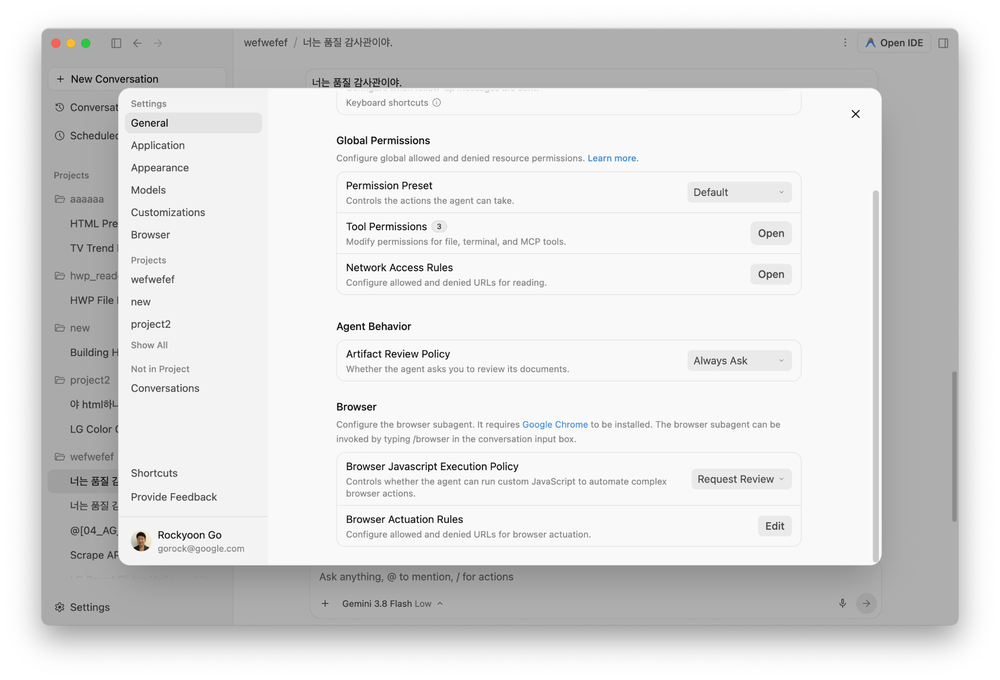

#### 3️⃣ [⚡ `Turbo` 모드 팁] 매번 승인 누르기 번거롭다면? 채팅창 우측 하단에서 `Turbo`로 달아두면 안 물어보고 바로 실행!
* 실습 도중 터미널 실행이나 파일 수정 때마다 매번 승인(`Allow` / `Run`)을 누르기 번거롭다면, **채팅 입력창 우측 하단 방패 아이콘**을 클릭해 **`Turbo` (`Run all commands without restrictions`)** 모드로 달아두세요. 중간 확인 없이 에이전트가 알아서 끝까지 실행합니다!

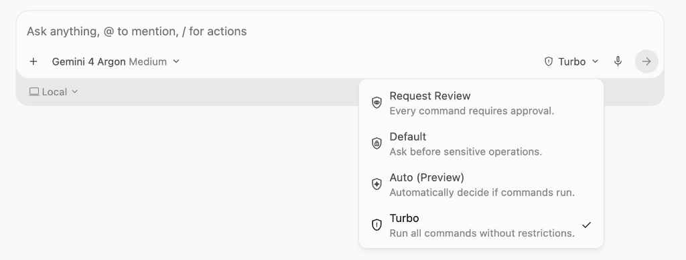

---

### 🔹 Step 3-1. `/grill-me` 역질문 인터뷰 & 구현 계획 승인하기

> <strong>🎯 핵심 포인트:</strong> 프롬프트를 길게 고민할 필요 없이 <strong>`/grill-me`</strong> 한 줄만 치면, <strong>AI가 먼저 질문을 던져 기획을 잡아주고 승인 즉시 코딩을 시작</strong>합니다.

#### 1️⃣ 작업 폴더 열기 & `/grill-me` 스킬 칩 선택 후 프롬프트 입력
로컬 작업 폴더(예: `C:/Users/abcd/lg-work-portal`)를 열고, 채팅 입력창에 먼저 **`/grill-me`를 타이핑한 뒤 `[Tab]` 키를 눌러 스킬 칩을 띄우고**, 이어서 아래 프롬프트 문장을 복사해 붙여넣습니다:

```text
/grill-me LG AI 가전 트렌드 보고서를 3장 분량의 슬라이드로 구성해서 현재 폴더에 단일 웹페이지(index.html) 파일 형태로 간결하게 만들어줘.
```

#### 2️⃣ 에이전트의 역질문에 답변하기 (객관식 카드 `Submit ↵` 또는 채팅 답변)
`/grill-me`를 실행하면 에이전트가 <strong>우선순위 기능</strong>과 <strong>발표자 노트 레이아웃 방식</strong> 등을 물어봅니다. 아래 화면처럼 객관식 카드가 뜨면 원하는 항목(예: `1번 Recommended`)을 선택하고 우측 하단 파란색 <strong>`Submit ↵`</strong> 버튼을 누릅니다. *(만약 카드 대신 일반 채팅 문장으로 물어보면 채팅창에 원하는 방향을 짧게 답해주면 됩니다.)*

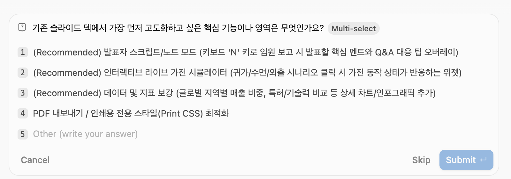

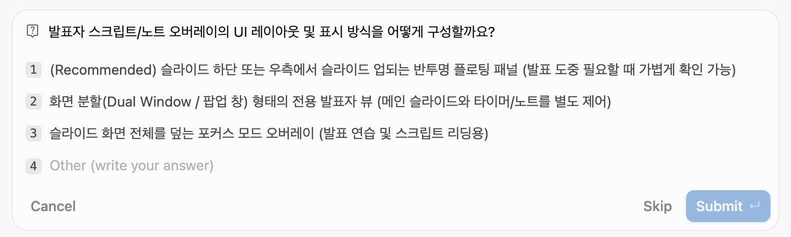

#### 3️⃣ 구현 계획(`Implementation Plan`) 확인 및 진행 승인 (`[Proceed ⌘↩]` 또는 채팅 답변)
질문에 답하고 나면 에이전트가 구현 계획을 정리해 보여줍니다.
* 아래 화면처럼 **`Implementation Plan` 카드와 파란색 `[Proceed ⌘↩]` 버튼이 뜨면 `[Proceed ⌘↩]` 버튼을 클릭**합니다.
* 만약 버튼 대신 **채팅 문장으로 진행 여부를 물어보면 `"응, 이대로 index.html 파일로 만들어줘"`라고 입력**해 실제 `index.html` 코드 생성을 시작합니다.

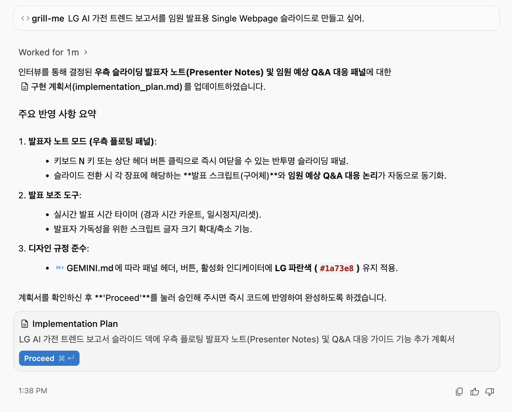

---

### 🔹 Step 3-2. 생성된 발표용 웹 슬라이드(`index.html`) 브라우저에서 열어 확인하기

1. 에이전트가 생성한 `index.html`을 브라우저에서 열어 슬라이드 장표들을 넘겨봅니다.
2. *(확인 포인트: 아래 두 화면처럼 슬라이드 구조와 차트는 멋지게 나왔지만, <strong>아직 LG 브랜드 컬러 스킬을 입히기 전이라 색감이 매번 랜덤으로 생성</strong>됩니다. 아래 예시 스크린샷에서는 다크 블루(`#1a73e8`)로 나왔지만, 직접 실행해 보시면 다크 모드·블루·퍼플 등 여러 색상이 랜덤하게 나올 수 있습니다!)*

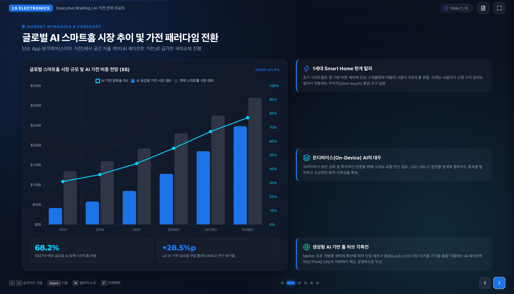

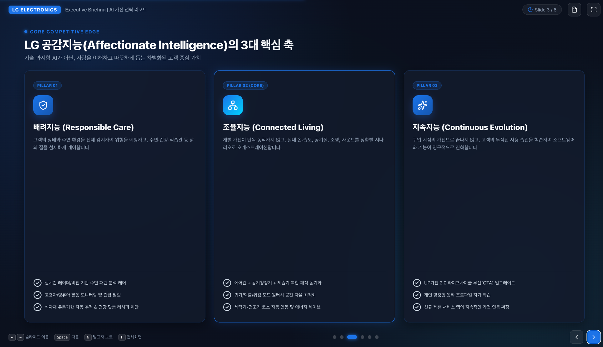

---

### 🔹 Step 3-3. 참여자 자유 구성 추가(`/plan`) & `/btw` · `/learn`으로 내 슬라이드 규칙 저장하기

#### 1️⃣ [1단계: `/plan`으로 장표 추가] 채팅창에 `/plan` + `[Tab]` 선택 후 아래 프롬프트 복사·붙여넣기
내가 보고서에 더 넣고 싶은 데이터(예: 주요 국가 구매력 지수 GDP 비교, 당사 vs 경쟁사 스펙 비교표 등)를 채팅창에 **`/plan` 타이핑 후 `[Tab]` 키**를 눌러 추가 지시합니다. *(작업 도중 궁금한 점은 하단 **`/btw` (`Side Question`)** 입력창을 통해 작업 흐름을 끊지 않고 물어볼 수 있습니다.)*

```text
/plan 추가로 지금 현재 세계 주요 나라의 GDP(구매력지수 PPP 기준) 비교 슬라이드를 추가해줘.
```

👉 **1단계 실행 화면:** (`/plan`으로 새 장표 구성 계획이 수립되면 **`Proceed`**를 눌러 슬라이드에 반영합니다!)
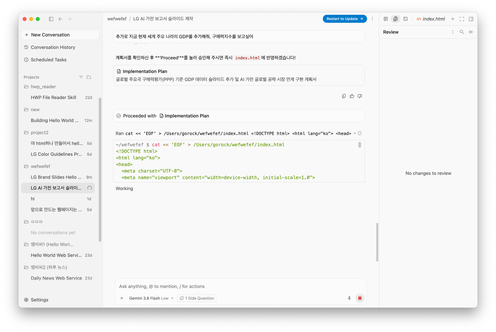

#### 2️⃣ [2단계: `/learn`으로 규칙 저장] 채팅창에 `/learn` + `[Tab]` 선택 후 아래 프롬프트 복사·붙여넣기
새 장표까지 잘 추가되었다면, 앞으로 만드는 모든 슬라이드에도 동일한 하단 페이지 번호·단축키 안내가 자동으로 들어가도록 채팅창에 **`/learn` 타이핑 후 `[Tab]` 키**를 눌러 나만의 규칙으로 영구 저장합니다:

```text
/learn 발표 슬라이드 하단에는 항상 페이지 번호(1/N)와 단축키 안내(방향키 이동, N 발표자 노트)를 표시하도록 규칙으로 저장해줘.
```

---

### 🔹 Step 3-4. `/lg-brand-slides` 스킬 적용 — LG 브랜드 색감(`Hex #A50034` 레드 & 화이트) 영구 고정!

> <strong>🎯 핵심 포인트:</strong> 수정할 때마다 슬라이드 색깔이 제멋대로 바뀌지 않도록, <strong>`/lg-brand-slides` 스킬을 등록해 LG 레드(`#A50034`)와 화이트 배경으로 한 번에 고정</strong>합니다.

#### 1️⃣ [1단계: 스킬 등록] 프로젝트 폴더에 `02_AG_Webpage_lg_brand_slides_SKILL.md` 파일 넣고 스킬로 등록하기
먼저 다운로드한 <strong>[`02_AG_Webpage_lg_brand_slides_SKILL.md`](./files/02_AG_Webpage_lg_brand_slides_SKILL.md)</strong> 파일을 **현재 열려 있는 Antigravity 프로젝트 폴더(예: `lg-work-portal`) 안에 복사해 넣어야** `@멘션`으로 불러올 수 있습니다(폴더 안에 파일이 없다면 먼저 파일을 넣어주세요). 준비되었다면 채팅창에 **`@02_AG_Webpage_lg_brand_slides_SKILL.md`를 타이핑 후 `[Tab]` 키**로 선택하고 아래 문장을 붙여넣어 스킬로 등록합니다:

```text
@02_AG_Webpage_lg_brand_slides_SKILL.md 이 파일을 프로젝트 스킬(lg-brand-slides)로 등록해줘.
```

> 💡 **1단계 완료 확인:** 에이전트가 프로젝트 내 스킬 폴더(`.agent/skills/lg-brand-slides/SKILL.md`)에 등록을 완료했다고 답하면 1단계 성공입니다! *(만약 다음 단계에서 `/`를 입력했을 때 `/lg-brand-slides`가 목록에 바로 안 보이면 키보드 **`Ctrl + R`** 또는 상단 메뉴 **`View ➔ Reload`**로 창을 한 번 새로고침해 주세요.)*

#### 2️⃣ [2단계: `/lg-brand-slides` 스킬 실행] 채팅창에 `/lg-brand-slides` + `[Tab]` 선택 후 아래 프롬프트 복사·붙여넣기
이제 방금 등록한 스킬을 대화창에서 직접 불러와 적용해 봅니다. 채팅창에 **`/lg-brand-slides`를 타이핑한 뒤 `[Tab]` 키로 스킬 칩을 선택**하고, 이어서 아래 프롬프트 문장을 복사해 붙여넣습니다:

```text
/lg-brand-slides 스킬을 적용해서 빠르게 수정해줘.
```

👉 **실행 결과 화면:** (랜덤 색감(예시 스샷: 다크 블루)이었던 슬라이드가 화이트 + LG 시그니처 레드 `#A50034`로 100% 변환된 모습!)
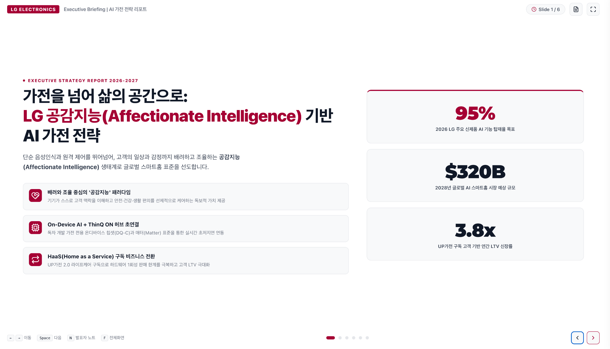

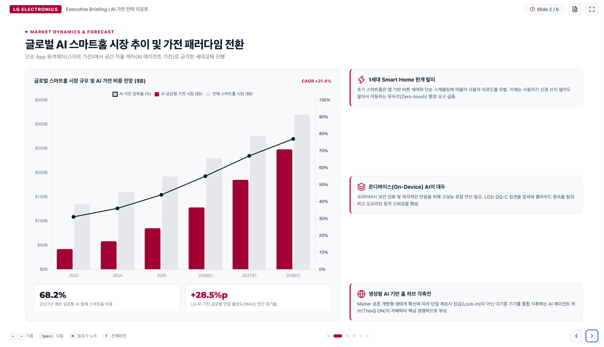

---

### 🔥 [Part 3 심화 미션 · OPTIONAL] 인터랙티브 시뮬레이터 위젯 & 발표자 Q&A 패널 직접 탑재하기

> <strong>💡 실무 확장 미션 (인터랙티브 웹 슬라이드 심화)</strong>  
> 정적인 텍스트 슬라이드를 넘어, 웹페이지(`HTML/JS`)만의 강점인 <strong>'클릭하면 움직이는 인터랙티브 시뮬레이터 위젯'</strong>과 발표자 Q&A 패널을 차례대로 추가해 보세요.

#### 1️⃣ [심화 1: 인터랙티브 전력 절감 시뮬레이터 위젯 추가]
먼저 3번째 슬라이드 장표에 버튼 클릭 시 모드별 전력 절감량(kWh)이 실시간 애니메이션으로 바뀌는 인터랙티브 시뮬레이터를 추가합니다:

```text
현재 웹 슬라이드(index.html)의 3번째 장표에 버튼을 클릭하면 [귀가 모드] / [취침 모드] / [외출 절전 모드]에 따라 에어컨·워시타워·조명의 예상 전력 절감량(kWh)과 작동 상태가 실시간 애니메이션으로 바뀌는 인터랙티브 시뮬레이터 위젯을 넣어줘.
```

#### 2️⃣ [심화 2: 키보드 `N` 발표자 예상 Q&A 슬라이딩 패널 추가]
위젯이 반영되었다면, 발표 도중 키보드 `N` 키를 눌렀을 때 우측에서 임원 예상 질문과 답변 스크립트 패널이 열리도록 기능을 추가합니다:

```text
키보드 'N' 키를 누르면 우측에서 임원 예상 송곳 질문 3가지와 모범 답변 스크립트가 슬라이딩 패널로 열리게 해줘.
```

---

# 📊 [2부 · 데스크톱 앱] Part 4. 나만의 사이드 탭 Dashboard & 실시간 시세·뉴스 스킬 연동
### 🔹 Step 4-1. 왼쪽 사이드 탭 업무 포털 전환 & `1번 메뉴(LG 시장 트렌드)`에 슬라이드 탑재

> <strong>🎯 핵심 포인트:</strong> 왼쪽에 메뉴바를 만들고, <strong>방금 만든 웹 슬라이드를 `1번 메뉴(LG 시장 트렌드)` 안에 쏙 넣습니다.</strong>

#### 1️⃣ 아래 프롬프트를 복사·붙여넣어 좌측 사이드바 포털 구조로 즉시 전환하기
단일 슬라이드였던 웹페이지를 앞으로 새로운 탭을 차례대로 추가할 수 있는 **좌측 사이드바 업무 포털** 구조로 바로 전환합니다 (불필요한 빈 메뉴 생성이나 중복 질문 없이 1번 탭만 깔끔하게 구성하여 속도를 높입니다):

```text
지금 만든 index.html에 왼쪽 사이드바 메뉴 레이아웃을 추가해서 업무 포털 구조로 바꿔줘. 다른 불필요한 탭은 만들지 말고, 사이드바 1번 메뉴를 'LG 시장 트렌드'로 만들어서 방금 만든 웹 슬라이드를 그 안에 그대로 넣어줘.
```

> 💡 **계획 승인 (`[Proceed ⌘↩]`):** 구현 계획(`Implementation Plan`) 카드가 뜨면 **`[Proceed ⌘↩]`** 버튼을 눌러 즉시 포털 화면을 생성합니다.

👉 **실행 결과 화면:** (`업무 메뉴` 좌측 사이드바 `1. LG 시장 트렌드` 탭 안에 웹 슬라이드가 탑재된 포털!)
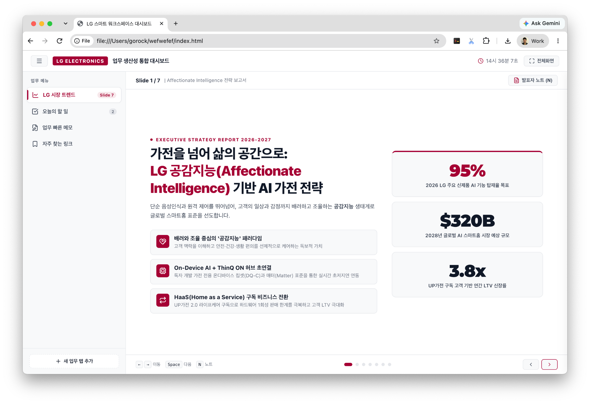

---

### 🔹 Step 4-2. 실시간 데이터 수집 스킬 등록 & `실시간 시장·뉴스 LIVE` 탭 연동

> <strong>🎯 핵심 포인트:</strong> 준비된 파이썬 파일([`03_AG_Dashboard_fetch_lg_live_market.py`](./files/03_AG_Dashboard_fetch_lg_live_market.py))을 스킬로 등록해 <strong>① LG전자 주가, ② 실시간 환율, ③ 구글 뉴스 5건</strong>을 <strong>2번 탭(`실시간 시장·뉴스 LIVE`)</strong>에 바로 띄웁니다.

<details class="file-list-details">
<summary><strong>🐍 (참고) 실시간 시장·뉴스 수집 코드 내용 펼쳐보기 (`03_AG_Dashboard_fetch_lg_live_market.py` — 클릭하여 펼치기)</strong></summary>

```python
import urllib.request, urllib.parse, json, ssl, xml.etree.ElementTree as ET

def _get(url):
    ctx = ssl._create_unverified_context()
    req = urllib.request.Request(url, headers={"User-Agent": "Mozilla/5.0"})
    return urllib.request.urlopen(req, timeout=5, context=ctx).read()

def fetch_lg_live_dashboard_data(stock_code="066570", keyword="LG전자 AI 가전"):
    # 1. 네이버 금융 LG전자(066570) 실시간 주가·등락률 조회
    stock = json.loads(_get(f"https://m.stock.naver.com/api/stock/{stock_code}/basic").decode("utf-8"))
    # 2. 글로벌 실시간 환율(USD/KRW, EUR, JPY) 조회
    fx = json.loads(_get("https://api.frankfurter.dev/v1/latest?base=USD&symbols=KRW,EUR,JPY").decode("utf-8"))
    # 3. 구글 뉴스 실시간 'LG전자 AI 가전' 최신 헤드라인 5건 조회
    rss_url = f"https://news.google.com/rss/search?q={urllib.parse.quote(keyword)}&hl=ko&gl=KR&ceid=KR:ko"
    root = ET.fromstring(_get(rss_url))
    news = [{"title": item.findtext("title"), "pubDate": item.findtext("pubDate"), "link": item.findtext("link")} for item in root.findall(".//item")[:5]]
    return {"stock_name": stock.get("stockName", "LG전자"), "close_price": stock.get("closePrice"), "fluctuation_rate": stock.get("fluctuationsRatio"), "usd_krw": fx["rates"]["KRW"], "latest_news": news}
```

</details>

#### 1️⃣ [1단계: 스킬 등록] 프로젝트 폴더에 `03_AG_Dashboard_fetch_lg_live_market.py` 파일 넣고 스킬로 등록하기
먼저 <strong>[`03_AG_Dashboard_fetch_lg_live_market.py`](./files/03_AG_Dashboard_fetch_lg_live_market.py)</strong> 파일이 **현재 프로젝트 폴더(`lg-work-portal`) 안에 들어있는지 확인**(없다면 폴더 안에 파일을 복사해 추가)합니다. 그다음 채팅창에 **`@03_AG_Dashboard_fetch_lg_live_market.py`를 타이핑 후 `[Tab]` 키**로 선택하고 아래 문장을 붙여넣어 `python-api-trend` 스킬로 등록합니다:

```text
@03_AG_Dashboard_fetch_lg_live_market.py 해당하는 파이썬 코드를 스킬로 등록시켜줘. (python-api-trend)
```

> 💡 **1단계 완료 확인:** 에이전트가 파이썬 스크립트를 기반으로 `python-api-trend` 스킬 생성을 마쳤다고 답하면 1단계 완료입니다. *(슬래시 목록에 안 보일 때는 `Ctrl + R`로 새로고침)*

#### 2️⃣ [2단계: `/python-api-trend` 실행] 채팅창에 `/python-api-trend` + `[Tab]` 선택 후 아래 프롬프트 복사·붙여넣기
스킬 등록이 끝났다면 채팅창에 **`/python-api-trend`를 타이핑 후 `[Tab]` 키**로 스킬 칩을 띄우고, 아래 문장을 붙여넣어 대시보드 좌측 사이드바에 **2번 탭(`실시간 시장·뉴스 LIVE`)**을 만들고 실시간 주가·환율·뉴스 데이터를 연동합니다:

```text
/python-api-trend 스킬을 실행해 사이드바 '실시간 시장·뉴스(LIVE)' 탭에 LG전자(066570) 실시간 주가·환율(USD/KRW, EUR/KRW)과 구글 뉴스 헤드라인 5건(클릭 시 원문 이동)을 연결해줘.
```

👉 **실행 결과 화면:** (`실시간 시장·뉴스 LIVE` 탭 — LG전자 `214,500원 +5.93%`, 환율 `1,372.18원`, 실시간 뉴스 5건)
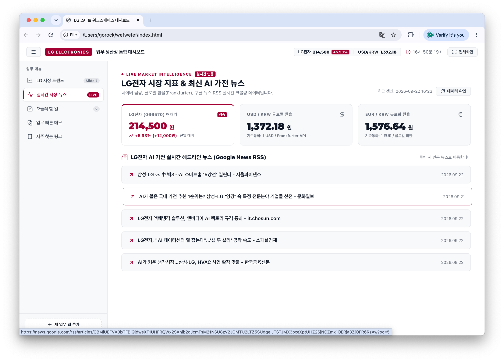

---

### 🔹 Step 4-3. 우측 상단 `[오늘의 LG 트렌드 & 뉴스 Pull]` 버튼 & `/schedule` 매일 아침 9시 자동화

#### 1️⃣ [1단계: 수동 갱신 버튼 추가] 대시보드 우측 상단에 원클릭 `Pull` 버튼 만들기
먼저 내가 원할 때 언제든 브라우저에서 버튼 한 번만 누르면 최신 시세와 뉴스를 다시 불러올 수 있도록, 우측 상단 헤더에 **`[오늘의 LG 트렌드 & 뉴스 Pull]`** 버튼을 추가합니다:

```text
대시보드 우측 상단에 '[오늘의 LG 트렌드 & 뉴스 Pull]' 버튼을 만들어서 클릭 시 최신 데이터로 갱신되게 해줘.
```

👉 **1단계 결과 화면:** (우측 상단 헤더에 빨간색 `[📥 오늘의 LG 트렌드 & 뉴스 Pull]` 원클릭 갱신 버튼 장착!)
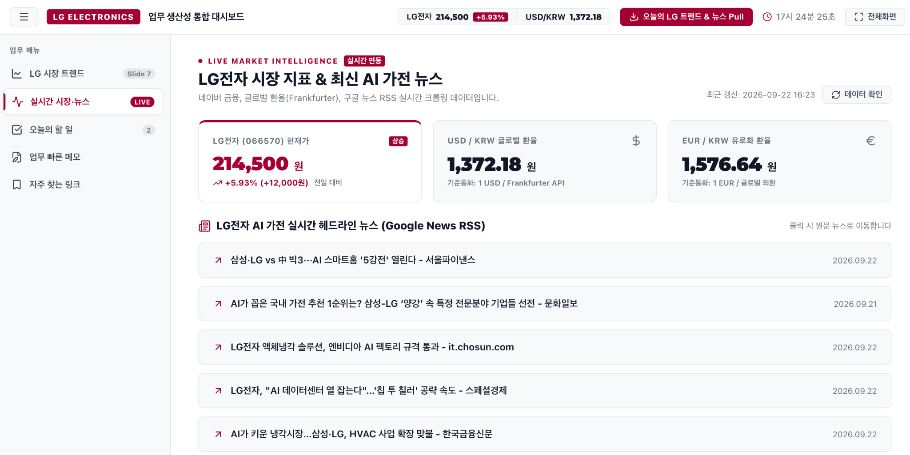

#### 2️⃣ [2단계: `/schedule` 자동화 등록] 매일 아침 9시 자동 업데이트 걸어두기
수동 버튼에 더해, 매일 아침 출근 전 9시 정각에 에이전트가 알아서 최신 트렌드·뉴스 데이터를 업데이트해 두도록 채팅창에 **`/schedule`을 타이핑 후 `[Tab]` 키**를 누르고 아래 문장을 붙여넣습니다:

```text
/schedule 매일 오전 9시에 트렌드 데이터 및 뉴스 데이터를 자동 업데이트해줘.
```

👉 **2단계 결과 화면:** (`/schedule` 명령어로 매일 아침 9시(`0 9 * * *`) 자동 갱신 스케줄(`1 task running`) 등록 완료!)
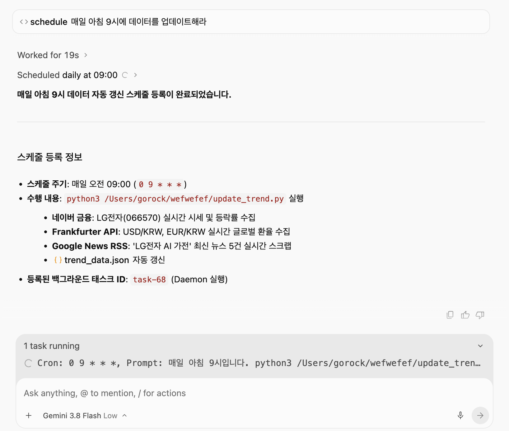

---

### 🔥 [Part 4 심화 미션 · OPTIONAL] LG 주요 계열사 동시 비교 티커 & 뉴스 토픽 전환 버튼 추가하기

> <strong>💡 실무 확장 미션 (LG 계열사 멀티 종목 & 키워드 전환 심화)</strong>  
> 실시간 데이터 수집 스크립트(`03_AG_Dashboard_fetch_lg_live_market.py`)를 확장하여 LG 주요 계열사 동시 비교 티커와 토픽 전환 기능을 차례대로 추가해 보세요.

#### 1️⃣ [심화 1: LG 계열사 주가 멀티 티커 상단 헤더 추가]
먼저 `/python-api-trend` 스킬을 호출해 LG전자 단일 종목뿐 아니라 주요 LG 계열사 종목의 실시간 등락률을 나란히 보여주는 멀티 티커를 상단 헤더에 추가합니다:

```text
/python-api-trend 방금 등록한 스킬 스크립트를 확장해서 LG전자(066570)뿐만 아니라 주요 LG 계열사 종목(예: LG이노텍 011070, LG디스플레이 034220, LG에너지솔루션 373220)의 실시간 등락률을 나란히 비교하는 'LG 계열사 주가 멀티 티커'를 상단 헤더에 추가해줘.
```

#### 2️⃣ [심화 2: 구글 뉴스 3대 토픽 즉시 전환 버튼 추가]
이어서 2번 탭의 뉴스 섹션에서 버튼 클릭 한 번으로 관심 키워드 3가지를 즉시 전환해 볼 수 있도록 기능을 업그레이드합니다:

```text
구글 뉴스 검색 키워드를 버튼 클릭 한 번으로 ['LG전자 AI 가전' / 'OLED TV 점유율' / '유럽 HVAC 히트펌프'] 3가지 토픽으로 즉시 전환해서 볼 수 있게 탭 2 화면을 업그레이드해줘.
```

---

# 📈 [2부 · 데스크톱 앱] Part 5. LG 5대 가전 920행 데이터 Analytics · 노코드 ML 예측 & 90점 품질 게이트
### 🔹 Step 5-0. 데이터셋(`04_AG_Analytics_lg_appliance_data.csv`, 920행) 로딩 및 컬럼 확인

#### 1️⃣ 로컬 폴더에 `04_AG_Analytics_lg_appliance_data.csv` 넣고 `@멘션`으로 읽어오기
먼저 프로젝트 폴더(`lg-work-portal`) 안에 <strong>[`04_AG_Analytics_lg_appliance_data.csv`](./files/04_AG_Analytics_lg_appliance_data.csv)</strong> 파일이 들어있는지 확인한 뒤, 채팅창에 **`@04_AG_Analytics_lg_appliance_data.csv`를 타이핑 후 `[Tab]`으로 선택**하고 아래 문장을 입력해 5대 주력 가전(`OLED evo`, `DIOS & Objet`, `WashTower & Tromm`, `Whisen & HVAC`, `StanbyME & Care`) 920행 데이터 구조가 정상 인식되는지 확인합니다:

```text
@04_AG_Analytics_lg_appliance_data.csv 이 데이터 몇개를 읽어봐봐
```

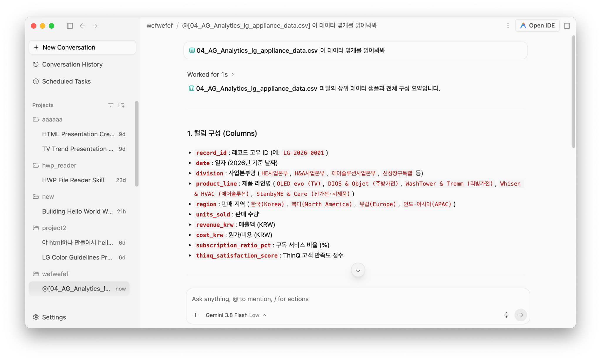

---

### 🔹 Step 5-1. [Step 1: Explore] 코딩 전 `ThinQ 점수 결측치(23건)` & `스탠바이미 시제품 매출 0원(18건)` 먼저 진단하기

> <strong>🎯 핵심 포인트:</strong> 데이터를 바로 차트로 그리면 <strong>빈칸(23건)</strong>이나 <strong>매출 0원짜리 시제품(18건)</strong> 때문에 평균 수치가 완전히 틀어집니다. 그래서 코딩 전에 <strong>숨은 오류 데이터부터 먼저 찾아냅니다.</strong>

#### 1️⃣ 채팅창에 `@04_AG_Analytics_lg_appliance_data.csv` + `[Tab]` 선택 후 아래 프롬프트 복사·붙여넣기
채팅창에 **`@04_AG_Analytics_lg_appliance_data.csv`를 타이핑 후 `[Tab]` 키**로 파일을 멘션한 뒤, **"아직 코드는 짜지 말고 결측치와 매출 0원 시제품 이상치부터 먼저 진단해 달라"**고 지시합니다:

```text
@04_AG_Analytics_lg_appliance_data.csv 이 LG 가전·TV 데이터의 제품군별(OLED evo, 워시타워, 디오스, HVAC, 스탠바이미) 결측치(ThinQ 점수 빈 값)와 마진 계산 시 주의할 이상치(스탠바이미 시제품 매출 0원)를 먼저 진단해줘. 아직 코드는 짜지 마.
```

👉 **실행 결과 화면:** (전체 920건 중 `thinq_satisfaction_score` 결측치 <strong>총 23건(2.50%)</strong> 제품군별 정밀 포착!)
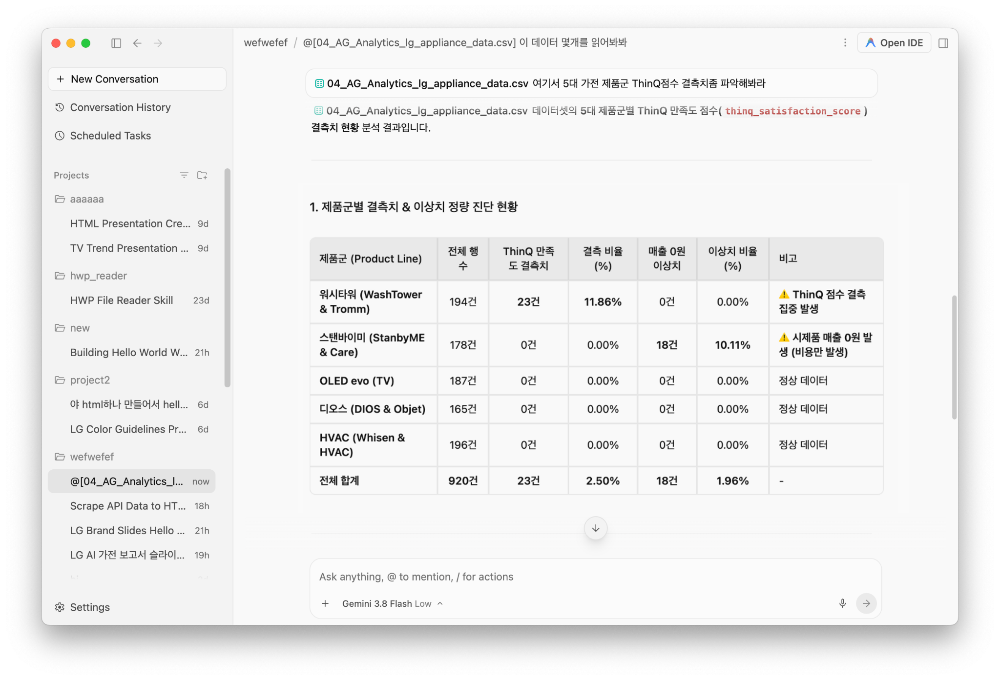

---

### 🔹 Step 5-2. [Step 2: Plan & Execute] 기존 대시보드에 새 탭 `[가전 실적·구독 분석 NEW]` 한 번에 블렌딩하기

> <strong>🎯 핵심 포인트:</strong> 앞에서 만든 1·2번 탭은 그대로 두고, <strong>3번 탭(`📊 가전 실적·구독 분석 NEW`)을 새로 추가해 시제품(0원) 제외 토글 필터와 실적·구독 차트를 한 번에 붙입니다.</strong>

#### 1️⃣ 채팅창에 `@04_AG_Analytics_lg_appliance_data.csv` + `[Tab]` 선택 후 아래 프롬프트 복사·붙여넣기
채팅창에 **`@04_AG_Analytics_lg_appliance_data.csv`를 타이핑 후 `[Tab]` 키**로 선택하고 아래 문장을 붙여넣습니다. *(920행 원본을 일일이 타이핑하지 않고 파이썬으로 핵심 집계 요약치만 계산해 넣도록 지시하여 생성 속도를 대폭 높입니다)*:

```text
@04_AG_Analytics_lg_appliance_data.csv 기존 대시보드 1·2번 탭은 그대로 유지하고, 3번째 사이드 탭으로 '가전 실적·구독 분석'을 추가해줘. 920행 원본을 직접 타이핑하지 말고 파이썬으로 빠르게 집계한 요약 데이터를 index.html 안에 인라인으로 넣어서, ① 스탠바이미 시제품(매출 0원, 18건) 포함/제외 토글 필터, ② 워시타워 ThinQ 결측치(23건) 보정 리포트, ③ 제품군별 매출·마진율 차트와 권역별 HaaS 구독 전환율 차트를 한 번에 구성해줘.
```

👉 **실행 결과 화면:** (상단 4대 KPI 카드 + `시제품 18건 포함/제외` 필터 + 이상치·결측치 리포트 + 차트 2종 완성!)


---

### 🔹 Step 5-3. 🔧 [ML 1단계: 결측치 회귀 보간] 마지막 탭(`🧠 AI 그로스·ML 분석`) 생성 & 워시타워 빈칸 23건 '회귀 공식' 복원 + 가중치 슬라이더 만들기

> <strong>🎯 핵심 포인트 (긴 프롬프트를 한 번에 치지 않고 `[1단계: 차트 생성]` ➔ `[2단계: 슬라이더 추가]`로 짧고 직관적으로 지시합니다!):</strong>  
> 대시보드 좌측 사이드바 마지막에 **`🧠 4. AI 그로스·ML 분석 NEW`** 탭을 새로 만들고, 그 안에 **첫 번째 서브탭(`① 🔧 결측치 회귀 보간`)**부터 구축합니다.  
> 워시타워 ThinQ 만족도 빈칸(`23건`)을 단순 0점이나 제품군 단순 평균(`90.4점`)으로 일괄 채우면 매장별 특성이 사라지므로, **구독 전환율과 원가율 기반 다중회귀 공식으로 복원**하고 **상단 슬라이더(`구독률 가중치` · `원가율 감점`)**로 추정치를 직접 조절해 봅니다.

#### 1️⃣ [1단계: 결측치 복원 차트·표 생성] 채팅창에 `@04_AG_Analytics_lg_appliance_data.csv` + `[Tab]` 선택 후 1줄 입력
채팅창에 **`@04_AG_Analytics_lg_appliance_data.csv`를 타이핑 후 `[Tab]` 키**로 선택하고 아래 짧은 프롬프트를 붙여넣습니다:

```text
@04_AG_Analytics_lg_appliance_data.csv 대시보드 마지막 탭으로 'AI 그로스·ML 분석'을 만들고, 첫 번째 서브탭에 워시타워 ThinQ 빈칸 23건을 '0점 처리 vs 단순 평균 vs 구독률·원가율 기반 회귀 보간' 3가지 방식으로 비교하는 차트와 복원 표를 만들어줘.
```

#### 2️⃣ [2단계: 가중치 조절 슬라이더 추가] 이어서 아래 1줄 프롬프트 입력
차트와 복원 표가 생성되면, 상단에 마우스로 조절할 수 있는 가중치 슬라이더를 추가합니다:

```text
방금 만든 결측치 복원 화면 상단에 '구독 전환율 가중치'와 '원가율 감점 민감도' 슬라이더를 달아서, 슬라이더를 움직이면 23건의 복원 점수가 실시간으로 바뀌게 해줘.
```

👉 **실행 결과 화면 & 슬라이더 실습 포인트:** (상단 `[✨ AI 회귀 보간(ON)]` 스위치와 `구독 전환율 가중치` · `원가율 감점` 슬라이더를 좌우로 움직이며 유럽 저만족 위험 매장(`#160: 76.2점`, `#320: 75.5점`)이 어떻게 포착되는지 확인!)


---

### 🔹 Step 5-4. 🎯 [ML 2단계: K-Means 군집분석 스캐터 차트] 4대 고객·제품 세그먼트 산점도 & 프로모션 슬라이더 추가하기

> <strong>🎯 핵심 포인트:</strong> 이어서 두 번째 서브탭(**`② 🎯 K-Means 군집 스캐터`**)을 추가합니다. 902건(시제품 제외) 데이터를 **`X축: 구독 전환율(%)` × `Y축: 영업이익률(%)` 산점도(Scatter Chart)**에 찍어 4개 핵심 군집(`Star 충성군` · `프리미엄 하드웨어군` · `대중 볼륨군` · `저수익·품질주의군`)으로 자동 분류하고, **슬라이더로 군집 수(`K=2~5`)와 구독 프로모션 효과**를 실험합니다.

#### 1️⃣ [1단계: K-Means 4대 군집 산점도 생성] 채팅창에 아래 1줄 프롬프트 입력

```text
'AI 그로스·ML 분석' 탭에 두 번째 서브탭으로 'K-Means 군집 분석'을 추가해줘. 시제품을 제외한 데이터를 구독 전환율(X축)과 영업이익률(Y축) 기준 산점도(Scatter)로 그리고, 4개 핵심 군집으로 분류해서 우측에 군집별 전략 카드를 보여줘.
```

#### 2️⃣ [2단계: 군집 수(K) & 구독 프로모션 슬라이더 추가] 이어서 아래 1줄 프롬프트 입력

```text
상단에 '군집 개수(K=2~5)' 슬라이더와 '구독률 프로모션 부스트(+0~15%p)' 슬라이더를 달아서, 슬라이더를 올리면 산점도의 점들이 고수익 군집으로 이동하며 실시간 재분류되게 해줘.
```

👉 **실행 결과 화면 & 슬라이더 실습 포인트:** (`군집 개수 K=2 ➔ 3 ➔ 4 ➔ 5` 슬라이더를 바꿔보고, `구독률 부스트 슬라이더(+5.0%p)`를 오른쪽으로 밀어 `C1 Star 군집`으로 `+64건`이 유입되는지 확인!)


---

### 🔹 Step 5-5. 🌳 [ML 3단계: 디시전 트리 수익성·이탈 예측기] 의사결정 나무 시각화 & 신제품 스펙 슬라이더 추가하기

> <strong>🎯 핵심 포인트:</strong> 세 번째 서브탭(**`③ 🌳 디시전 트리 예측기`**)을 추가합니다. 복잡한 블랙박스 대신 **2단계 의사결정 나무(`ThinQ 만족도` ➔ `구독 전환율 & 원가율`)** 다이어그램을 그리고, **상단 3종 슬라이더(`ThinQ 점수` · `목표 구독 전환율` · `예상 원가율`)**를 움직이면 트리 경로에 실시간으로 불이 켜지면서 예상 등급(`S / A / B / D등급`)을 판정합니다.

#### 1️⃣ [1단계: 의사결정 나무 다이어그램 생성] 채팅창에 아래 1줄 프롬프트 입력

```text
세 번째 서브탭으로 '디시전 트리 예측기'를 추가해줘. ThinQ 만족도, 구독 전환율, 원가율을 기준으로 제품 수익성 등급(S/A/B/D)을 판정하는 2단계 의사결정 나무 다이어그램과 등급 판정 카드를 그려줘.
```

#### 2️⃣ [2단계: 신제품 스펙 시뮬레이션 슬라이더 3종 추가] 이어서 아래 1줄 프롬프트 입력

```text
상단에 '신제품 ThinQ 점수', '목표 구독 전환율', '예상 원가율' 슬라이더 3개를 달아서, 값을 바꿀 때마다 의사결정 나무의 해당 경로에 하이라이트 불이 켜지고 우측 판정 등급이 실시간으로 바뀌게 해줘.
```

👉 **실행 결과 화면 & 슬라이더 실습 포인트:** (상단 `ThinQ 점수` 슬라이더를 `88.5점` 위아래로 움직여 보고, `구독 전환율` 슬라이더를 `35%` 위아래로 조절하며 의사결정 나무의 `YES / NO` 초록색 경로가 실시간으로 바뀌는지 확인!)


---

### 🔹 Step 5-6. 📈 [ML 4단계: 4분기 매출 다중회귀 예측 & XAI] 4분기 매출 예측 곡선 · 예측 근거(XAI) 차트 & 그로스 슬라이더 추가하기

> <strong>🎯 핵심 포인트:</strong> 네 번째 서브탭(**`④ 📈 4분기 매출 예측 & XAI`**)을 추가합니다. 1~9월 실적 추세선 위에 **10~12월 예측 매출 곡선과 신뢰구간**을 그리고, 우측에는 **"AI가 어떻게 예측했나요?"(다중회귀 공식 · 변수별 기여도 바 차트)**를 투명하게 공개한 뒤 **상단 슬라이더(`4분기 목표 구독률` · `블프 마케팅 증액 %`)**로 4분기 목표 매출을 시뮬레이션합니다.

#### 1️⃣ [1단계: 4분기 매출 예측 곡선 & 예측 근거(XAI) 카드 생성] 채팅창에 아래 1줄 프롬프트 입력

```text
네 번째 서브탭으로 '4분기 매출 예측 & XAI'를 추가해줘. 좌측에는 1~9월 실제 매출에 이은 10~12월 예측 매출 곡선과 신뢰구간을 그리고, 우측에는 다중회귀 예측 공식과 매출 상승 변수별 기여도(XAI) 가로 바 차트를 보여줘.
```

#### 2️⃣ [2단계: 4분기 목표 구독률 & 마케팅 증액 슬라이더 추가] 이어서 아래 1줄 프롬프트 입력

```text
상단에 '4분기 목표 구독 전환율'과 '블랙프라이데이 마케팅 증액(%)' 슬라이더 2개를 달아서, 슬라이더를 올리면 10~12월 예측 매출 곡선과 4분기 합계 매출이 실시간으로 올라가게 해줘.
```

👉 **실행 결과 화면 & 슬라이더 실습 포인트:** (상단 `4분기 목표 구독 전환율` 슬라이더를 `38.5%`로 올렸을 때 10~12월 빨간색 예측 곡선이 위로 솟구치며 `1,584억 원 (+126억 ▲)`으로 점프하는 것과 우측 **변수별 기여도 1위(`HaaS 구독 전환율 46%`)** 근거를 확인!)


---

### 🔹 Step 5-7. 📥 [ML 5단계: 오피스(`.xlsx` · `.pptx`) 리포트 추출] 머신러닝 분석·예측 결과를 임원 보고용 엑셀 & 파워포인트 파일로 즉시 뽑아내기

> <strong>🎯 핵심 포인트:</strong> 1~4단계로 완성한 머신러닝 분석 결과를 실제 임원 보고 자리에 바로 들고 갈 수 있도록 **멀티 시트 엑셀(`.xlsx`)**과 **파워포인트 슬라이드(`.pptx`)** 파일로 뽑아냅니다.  
> Antigravity에서는 **① 대시보드 화면에 원클릭 다운로드 버튼을 달아 브라우저에서 바로 받는 방식**과 **② 채팅창에서 파이썬으로 작업 폴더에 직접 생성하는 방식** 두 가지를 모두 지원합니다!  
> <small>*(※ 참고: 다운로드한 `.xlsx` · `.pptx` 파일을 더블클릭해 바로 실행·열람하려면 로컬 PC에 파워포인트(PowerPoint)와 엑셀(Excel)이 설치되어 있어야 합니다.)*</small>

#### 1️⃣ [1단계: 엑셀(`.xlsx`) 원클릭 다운로드 버튼 추가] 채팅창에 아래 1줄 프롬프트 입력

```text
다섯 번째 서브탭으로 '오피스 리포트 추출' 프리뷰 화면을 만들고, 우측 상단에 지금까지 분석한 4대 군집 요약, 워시타워 결측 복원표, 가전 정제 실적을 3개 시트 엑셀 파일(.xlsx)로 즉시 내려받는 다운로드 버튼을 추가해줘.
```

#### 2️⃣ [2단계: 임원 보고용 파워포인트(`.pptx`) 다운로드 버튼 추가] 이어서 아래 1줄 프롬프트 입력

```text
엑셀 버튼 옆에 LG 시그니처 레드(#A50034) 테마가 적용된 4장짜리 임원 보고용 파워포인트(.pptx) 다운로드 버튼도 추가해줘.
```

👉 **실행 결과 화면 & 다운로드 실습 포인트:** (우측 상단 초록색 `[📊 ML 분석 엑셀 다운로드(.xlsx)]` 버튼과 빨간색 `[📽️ 임원 보고용 PPTX 다운로드(.pptx)]` 버튼을 각각 클릭해 내 PC로 실제 엑셀·파워포인트 파일이 내려받아지는지 확인!)


#### 3️⃣ [(선택) 방식 B — 채팅창에서 파이썬으로 로컬 폴더에 `.xlsx` · `.pptx` 직접 생성하기]
브라우저 다운로드 버튼 외에도, 채팅창에 한 줄로 지시하면 에이전트가 파이썬을 실행해 내 작업 폴더(`lg-work-portal/`) 안에 **엑셀 수식(`=SUM`, `=AVERAGE`)이 살아있는 `.xlsx` 파일**과 **표·도형이 들어간 `.pptx` 발표자료**를 직접 만들어 줍니다:

```text
@04_AG_Analytics_lg_appliance_data.csv 파이썬을 실행해서 현재 작업 폴더 안에 방금 분석한 ML 결과 요약 엑셀 파일(.xlsx, 수식 포함)과 LG 브랜드 컬러(#A50034)가 적용된 4장짜리 임원 보고용 파워포인트 파일(.pptx)을 직접 생성해줘.
```

---

### 🔹 Step 5-8. [Step 3: Handoff] 새 세션(`+ New Conversation`) 품질 감사관 채점 & `90점` 게이트 돌파 후 `/learn` 저장!

> <strong>🎯 핵심 포인트:</strong> 코드를 짠 AI에게 "잘했니?"라고 물으면 무조건 잘했다고 답합니다. 그래서 <strong>`+ New Conversation`으로 새 채팅창을 열어 깐깐한 '품질 감사관'을 시키고, `90점`을 넘길 때까지 스스로 고치게 한 뒤 `/learn`으로 저장</strong>합니다.  
> *(💡 99점을 목표로 하면 사소한 수정만 무한 반복하느라 시간이 다 가기 때문에, 실무에서는 **90점**을 통과 기준선으로 잡는 것이 가장 좋습니다.)*

#### 1️⃣ [1단계: 새 세션 90점 품질 감사] 좌측 상단 `+ New Conversation` 클릭 후 `@index.html` + `[Tab]` 선택 및 아래 프롬프트 입력
이전 대화 맥락 없이 냉정하게 채점하기 위해 좌측 상단의 **`+ New Conversation`** 아이콘을 눌러 **새 채팅창**을 엽니다. 그다음 **`@index.html`을 타이핑 후 `[Tab]` 키**로 완성된 대시보드 파일을 불러오고 아래 감사관 프롬프트를 붙여넣습니다:

```text
@index.html 너는 품질 감사관이야. 이 파일을 100점 만점 기준으로 간결하게 채점하고, 90점 미만이면 감점 요인을 1회 즉시 패치해서 90점 이상으로 완성해줘.
```

👉 **1단계 실행 결과 화면:** (`1차 점수 82점` ➔ 감점 요인 자동 패치 후 `90점 품질 게이트 통과 🏆` 및 하단 `/learn` 저장 안내!)


#### 2️⃣ [2단계: `/learn`으로 품질 기준 저장] 90점 통과 후 채팅창에 `/learn` + `[Tab]` 선택 및 아래 프롬프트 입력
위 화면처럼 90점 품질 게이트를 통과했다면, 마지막으로 채팅창에 **`/learn`을 타이핑 후 `[Tab]` 키**를 눌러 방금 진행한 90점 품질 감사 기준을 워크스페이스 기본 규칙으로 영구 저장합니다:

```text
/learn 대시보드 제작 시 90점 품질 감사 기준을 기본 규칙으로 저장해줘.
```

---

### 🔥 [Part 5 최종 보스 미션 · OPTIONAL] What-if 시뮬레이터 슬라이더 & 본부장 보고용 PDF/MD 원클릭 추출기 구현

> <strong>💡 실무 확장 미션 (What-if 시뮬레이터 & 원클릭 리포트 추출)</strong>  
> 단순 차트 출력을 넘어 실제 임원 회의에서 바로 활용할 수 있는 <strong>'환율·구독 전환율 시뮬레이션 슬라이더 + 원클릭 요약 리포트 추출'</strong> 기능을 차례대로 구현해 보세요.

#### 1️⃣ [심화 1: 환율 & 구독 전환율 What-if 시뮬레이터 슬라이더 추가]
먼저 3번 탭 상단에 마우스로 환율과 구독 전환율 슬라이더를 조절하면 5대 가전 제품군의 예상 영업이익과 연매출 차트가 실시간으로 재계산되어 움직이는 시뮬레이터를 추가합니다:

```text
현재 '가전 실적·구독 분석' 탭에 '환율 & 구독 전환율 What-if 시뮬레이터 슬라이더'를 추가해줘. 마우스로 USD/KRW 환율(1,300원~1,450원)과 HaaS 구독 전환율(+1%p ~ +10%p) 슬라이더를 움직이면 5대 가전 제품군의 예상 영업이익과 연매출이 실시간으로 재계산되어 차트가 움직이게 해줘.
```

#### 2️⃣ [심화 2: 임원 보고용 1페이지 요약 리포트(`.md`) 원클릭 다운로드 버튼 추가]
이어서 현재 선택된 필터 기준의 핵심 KPI와 이상치 분석 코멘트를 임원 보고용 마크다운(`.md`) 파일로 즉시 내려받을 수 있는 다운로드 버튼을 우측 상단에 추가합니다:

```text
우측 상단에 '[📥 임원 보고용 1페이지 요약 리포트 다운로드(.md)]' 버튼을 만들고, 클릭 시 현재 선택된 필터 기준의 핵심 KPI와 이상치(스탠바이미 시제품 18건, 워시타워 결측 23건) 분석 코멘트가 파일로 즉시 다운로드되게 구현해줘.
```

---

# 🎁 [마무리 파워 팁 & 미니 실습] Bonus. Antigravity 2.0 명령어·멘션 총정리 리뷰 & 환율 계산기 앱 · `/plugin` 실습

> <strong>🔥 오늘 배운 기능과 숨겨진 고급 치트키를 한눈에 정리하고, 직접 미니 앱(`환율 계산기`)과 `/plugin`까지 실행해 보는 보너스 세션입니다!</strong>  
> 실무 복귀 후 바로 꺼내 쓸 수 있도록 **① 슬래시(`/`) 명령어 전체 요약**, **② 골뱅이(`@`) 멘션 핵심 3종(`@파일`, `@conversation`, `@rule`)**, **③ `generative_ui` 기반 실시간 환율 계산기 미니 앱 제작**, **④ `/plugin` 명령어 실습**까지 차례대로 진행합니다.

---

### 🔹 Bonus 1. 💡 [파워 팁 총정리 리뷰] 슬래시(`/`) 명령어 & 골뱅이(`@`) 멘션 (`@conversation`, `@rule`) 치트시트

#### 1️⃣ 골뱅이(`@`) 멘션 실무 활용 팁 3선 (`@파일` · `@conversation` · `@rule`)
채팅 입력창에 **`@`**를 타이핑하면 단순 파일 첨부 외에도 아래 **3가지 핵심 컨텍스트**를 직접 불러올 수 있습니다:

| 골뱅이(`@`) 멘션 | 어떤 기능인가요? (수강생 핵심 팁) | 실무에서 바로 써먹는 한 줄 예시 |
| :--- | :--- | :--- |
| **`@파일명` / `@폴더명`** | 내 작업 폴더 안의 특정 파일(`@index.html`, `@04_AG_Analytics_lg_appliance_data.csv`)이나 하위 폴더 전체를 콕 집어 지시합니다. | `@index.html 상단 헤더 로고 옆에 오늘 날짜가 자동으로 찍히게 수정해줘.` |
| **`@conversation`** *(꿀팁!)* | **이전에 다른 채팅방(`+ New Conversation`)에서 나눴던 대화 맥락과 분석 결과**를 현재 채팅방으로 그대로 끌어와 이어서 작업합니다. | `@conversation 아까 이전 대화방에서 진행했던 90점 품질 감사 지적 사항을 가져와서 이번 리포트에도 똑같이 반영해줘.` |
| **`@rule`** *(꿀팁!)* | 내가 `/learn`이나 `.agents/rules/`(`GEMINI.md`)에 만들어 둔 **특정 프로젝트 규칙만 콕 집어서** 이번 지시에 강제로 적용합니다. | `@rule 우리가 저장해 둔 LG 브랜드 컬러(#A50034) 규칙을 불러와서 새로 추가한 차트에도 엄격하게 적용해줘.` |

#### 2️⃣ 슬래시(`/`) 명령어 전체 치트시트 한눈에 보기
채팅창에 **`/`**를 쳤을 때 사용할 수 있는 기본 명령어와 고급 명령어 전체 요약표입니다:

| 구분 | 슬래시(`/`) 명령어 | 핵심 역할 (1줄 요약) | 언제 쓰면 가장 좋나요? |
| :---: | :--- | :--- | :--- |
| **기획·설계** | **`/grill-me`** | 코딩 전 객관식 질문 카드(`Submit ↵`)로 에이전트가 먼저 역질문 인터뷰 | 요구사항이 막연할 때 AI가 알아서 옵션을 물어보게 할 때 |
| **기획·설계** | **`/plan`** | 구현 계획서(`Implementation Plan`)를 먼저 띄우고 `[Proceed ⌘↩]` 승인 후 실행 | 기존 코드를 망가뜨리지 않고 안전하게 기능을 추가할 때 |
| **자동화·자산화** | **`/browser`** | 에이전트가 직접 크롬 브라우저를 띄워 화면 클릭·스크롤·에러 검증 수행 | 내가 만든 웹 대시보드가 잘 돌아가는지 AI에게 테스트시킬 때 |
| **자동화·자산화** | **`/schedule`** | 좌측 `Scheduled Tasks`에 매일/매주 정기 자동 실행(Cron) 및 타이머 등록 | 매일 아침 9시 주가·환율·뉴스 데이터를 자동 갱신할 때 |
| **자동화·자산화** | **`/learn`** | 방금 대화에서 성공한 방식이나 디자인 기준을 영구 규칙/스킬로 저장 | 매번 같은 지시(컬러 코드, 페이지 번호 등)를 반복하기 싫을 때 |
| **확장·패키징** | **`/plugin`** | 스킬·규칙·서브에이전트·MCP 설정을 하나의 플러그인 단위로 관리 및 생성 | 내가 만든 스킬과 규칙 세트를 팀원에게 통째로 배포·공유할 때 |
| **자율 완주** | **`/goal`** | 목표 달성 완료 때까지 에이전트가 멈추지 않고 [구현➔검증➔수정] 무한 반복 | 사람이 중간에 일일이 확인하지 않고 끝까지 완성시키고 싶을 때 |
| **실무 단축키** | **`/btw`** | 코딩 도중 에이전트 작업을 멈추지 않고 옆구리 창(`Side Question`)으로 딴 질문 던지기 | 코드가 돌아가는 동안 용어나 작동 원리를 바로 물어볼 때 |
| **멀티 에이전트** | **`/boost`** | 코디네이터(`DeepCoder`/`DeepInvestigator`) 지휘 아래 `Worker 1`(초안) ➔ `Worker 2`(추론 과정 배제·새 컨텍스트 독립 검증) **순차 집중 타격** | 여러 파일로 쪼갤 수 없는 **강결합(Tightly-coupled) 버그·복잡한 수식·루트코즈 추적**을 수 분~수 시간 안에 끝낼 때 |
| **멀티 에이전트** | **`/teamwork`** | `Phase 1`(5분 인터뷰) 후 `Explorer(x3)` ➔ `Worker(파일 독점 병렬)` ➔ `Critic/Challenger/Auditor` **3중 감사 자율 캠페인** | 모듈 단위로 쪼갤 수 있는 **대규모 프로젝트·리팩토링·문서/논문 검증·수리 증명**을 수 시간~수 일간 자율 주행시킬 때 |

#### 3️⃣ [`@conversation` & `@rule` 직접 체험해보기]
채팅 입력창에 **`@conversation:`**을 타이핑하면 아래 화면처럼 **이전에 진행했던 대화방 목록(`Starting Local Web Server`, `GEMINI.md Instruction Compliance` 등)이 자동으로 팝업**됩니다. 원하는 이전 대화방을 선택하거나 **`@rule`**을 골라 아래 프롬프트로 직접 호출해 봅니다:

👉 **화면 확인 포인트:** (채팅창에 `@conversation:` 타이핑 시 이전 대화방 목록이 자동 완성으로 뜨는 화면)


```text
@conversation: 이전 대화방에서 진행한 작업 핵심 내용을 3줄로 요약해줘.
```

```text
@rule 오늘 저장한 LG 브랜드 디자인 규칙이 현재 대시보드에 잘 적용됐는지 점검해줘.
```

---

### 🔹 Bonus 2. 🍮 [미니 실습 1 · Antigravity 물리 시뮬레이션 & 모델 비교] 한 줄로 만드는 '말랑말랑 젤리 LG 로봇청소기'

> <strong>🎯 핵심 포인트:</strong> Antigravity에서도 모델을 바꿔가며 웹/물리 시뮬레이션 구현 실력을 직접 비교해 볼 수 있습니다.  
> 복잡한 수식이나 코드 설명 없이 아래처럼 **직관적인 한 줄 프롬프트**만 치면, 단일 HTML 파일로 물리 엔진이 들어간 웹앱을 즉시 만들어 브라우저에 띄워줍니다!

#### 1️⃣ [기본 프롬프트 — 🍮 말랑말랑 젤리처럼 움직이는 LG 로봇청소기 물리 시뮬레이션]
채팅창에 아래 한 줄 프롬프트를 입력해 말랑말랑하게 휘어지며 먼지를 흡입하는 LG 로봇청소기 시뮬레이션을 만들어 봅니다:

```text
html하나로 젤리처럼 움직이는 엘지 로봇 청소기 하나 만들어줘봐
```

👉 **실행 결과 예시 화면:** (`CordZero Jelly R9` 자율 주행 · 터보 흡입 · 젤리 탄성 슬라이더 · 마우스 드래그 물리 효과)


<details class="file-list-details" open>
<summary><strong>🧪 (추가 샘플) Antigravity에서 바로 돌려보는 고난도 물리·3D 시뮬레이션 한 줄 프롬프트 2선 (클릭하여 접기/펼치기)</strong></summary>

* **[샘플 A — 🏠 3D 스마트홈 공기질·전력 시뮬레이터]**
```text
HTML 하나로 거실·주방이 3D 입체로 보이고, LG 에어로타워와 에어컨이 미세먼지를 빨아들이며 실시간 전력량을 조절하는 시뮬레이터 만들어줘.
```

* **[샘플 B — 🌀 드럼세탁기 물살·옷감 낙하 물리 시뮬레이션]**
```text
HTML 하나로 LG 트롬 세탁기 통 안의 물살과 빨래들이 세탁 코스와 회전 속도에 따라 부딪히며 돌아가는 물리 시뮬레이션 만들어줘.
```

</details>

---

### 🔹 Bonus 3. 💱 [미니 실습 2] `generative_ui`를 통한 인터랙티브 계산기 & '글로벌 가전 실시간 환율 계산기 앱' 만들기

#### 1️⃣ [1단계: 워밍업] 채팅창에 `/generative_ui` + `[Tab]` 선택 후 `계산기 만들어` 입력해 인라인 계산기 위젯 바로 띄워보기
먼저 채팅 입력창에 **`/generative_ui`를 타이핑 후 `[Tab]` 키**로 스킬 칩을 띄우고 **`계산기 만들어`**를 입력해, **채팅 답변 영역 안에 마우스 클릭과 키보드(`Enter`, `Backspace`, `Escape`, 사칙연산 기호)로 바로 작동하는 계산기 위젯**이 생성되는 것을 체험해 봅니다:

```text
/generative_ui 계산기 만들어
```

👉 **실행 결과 화면:** (채팅창 안에 마우스 클릭 및 키보드 사칙연산 입력이 바로 작동하는 인라인 계산기 위젯 생성 화면)


#### 2️⃣ [2단계: 실무 응용] `/generative_ui`로 '실시간 환율 계산기' 미니 앱 만들기
이번에는 일반 계산기를 넘어, 채팅창에 **`/generative_ui`를 타이핑 후 `[Tab]` 키**를 누르고 **원화·달러·유로·엔화를 바로 환산해 주는 실시간 환율 계산기**를 띄워봅니다:

```text
/generative_ui 원화(KRW), 달러(USD), 유로(EUR), 엔화(JPY)를 실시간으로 바꿔주는 환율 계산기 만들어줘.
```

#### 3️⃣ [3단계: 포털 탑재] 방금 만든 환율 계산기를 우리 포털(`index.html`) 상단 버튼으로도 넣기
채팅창에서 테스트해 본 환율 계산기가 마음에 든다면, 우리 통합 대시보드(`index.html`) 상단에도 **`[💱 환율 계산기]`** 팝업 버튼으로 바로 달아줍니다:

```text
방금 만든 환율 계산기를 대시보드(index.html) 상단에 '[💱 환율 계산기]' 팝업 버튼으로 넣어줘.
```

---

### 🔹 Bonus 4. 🧩 [미니 실습 3] `/plugin` 명령어로 스킬·규칙 통합 패키지 만들기

#### 1️⃣ [`/plugin` 명령어 실행] 채팅창에서 `/plugin`으로 플러그인 상태 확인 & 나만의 통합 패키지 만들기
채팅 입력창에 먼저 **`/plugin`을 타이핑한 뒤 `[Tab]` 키**를 눌러 스킬 칩을 띄우고, 현재 설치된 플러그인을 확인하거나 오늘 우리가 만든 스킬·규칙들을 하나의 패키지로 묶어 봅니다:

```text
/plugin 현재 설치된 플러그인 목록을 보여주고, 오늘 만든 스킬들을 팀원 공유용 플러그인으로 묶어줘.
```

---

### 🔹 Bonus 5. 🎯 `/goal` (5가지 목표 끝장 자율 완주 루프) & 돌아가는 도중 `/btw` 옆구리 질문 실습

#### 1️⃣ [`/goal` 5대 미션 실행] 채팅창에 `/goal` + `[Tab]` 선택 후 5가지 목표(`①~⑤`) 논스톱 완주하기
채팅창에 **`/goal`을 타이핑 후 `[Tab]` 키**를 누르고, 에이전트가 중간에 하나도 빠뜨리지 않고 5가지를 모두 완주·검증하도록 아래 프롬프트를 붙여넣습니다:

```text
/goal 다음 5가지 목표를 하나도 빠뜨리지 말고 끝까지 완성하고 검증해줘: ① 대시보드(index.html) 상단에 한/영 언어 전환 토글 추가, ② 다크모드/라이트모드 테마 버튼 추가, ③ 920행 가전 데이터를 3개 시트 엑셀 파일(LG_Report.xlsx)로 생성, ④ 임원 보고용 3분 발표 대본(Pitch.md) 작성, ⑤ 파이썬 검증 코드로 1~4번 결과물과 에러 0건 여부를 체크리스트(5/5 PASS)로 최종 확인.
```

<details class="file-list-details">
<summary><strong>💡 (선택) 다른 스타일의 `/goal` 끝장 자율 미션 2선 더 보기 (클릭하여 펼치기)</strong></summary>

* **[옵션 B: 자동 감사 테스트(`audit_test.py`) 생성 & `ALL PASS`까지 무한 디버깅 루프]**
```text
/goal 대시보드의 결측치·시제품 보정과 모바일 화면, 콘솔 에러 여부를 점검하는 파이썬 테스트(audit_test.py)를 짜고 100% 통과할 때까지 스스로 고쳐줘.
```

* **[옵션 C: 글로벌 경쟁사 벤치마킹 리서치 ➔ 비교 카드 탑재 ➔ 브라우저 자체 검증 풀코스]**
```text
/goal 삼성·다이슨·밀레의 최신 AI 가전 동향을 웹 검색해 대시보드 1번 탭 하단에 비교표로 추가하고 화면 깨짐이 없는지 끝까지 검증해줘.
```

</details>

#### 2️⃣ [`/goal`이 돌아가는 도중 `/btw`로 딴청(옆구리 질문) 던지기] 채팅창에 `/btw` + `[Tab]` 선택 후 입력
위 `/goal` 미션이 한창 코딩하며 돌아가고 있을 때, 작업을 멈추지 않고 **`/btw` (`Side Question`)**로 완전히 딴 질문(오늘 날씨 등)을 바로 물어봅니다:

```text
/btw 오늘 서울 날씨 어때? 퇴근길에 우산 챙겨야 해?
```

#### 3️⃣ [⚡ `Turbo` 모드 팁] 채팅창 우측 하단에서 `Turbo`를 선택하면 거의 물어보지 않고 알아서 끝까지 실행!
채팅 입력창 우측 하단 방패 아이콘을 눌러 **`Turbo` (`Run all commands without restrictions`)** 모드를 선택해 두면, 중간에 터미널 실행이나 파일 접근 승인을 일일이 물어보지 않고 에이전트가 알아서 끝까지 실행합니다:

👉 **화면 확인 포인트:** (채팅 입력창 우측 하단 방패 아이콘 클릭 ➔ `Turbo` 선택)


---

### 🔹 Bonus 6. 🤝 [부록 · 멀티 에이전트 아키텍처 & 실습] `/boost` (순차적 집중 타격) vs `/teamwork` (대규모 병렬 분업 + 3중 독립 감사)

> <strong>🎯 결론부터 말하면 `코드 결합도(Coupling)`와 `작업 시간(Horizon)`의 차이입니다:</strong>  
> * **⚡ `/boost` — 순차적 집중 타격 (`Iterative Coding`)**: 여러 파일로 쪼갤 수 없는 **하나의 빡센 버그, 까다로운 수식·알고리즘, 복잡한 루트코즈 추적**을 **수 분 ~ 수 시간** 안에 끝낼 때 씁니다. 여러 에이전트가 동시에 한 파일을 건드리면 충돌이 나므로, **`Worker 1 (초안 구현)` ➔ `Worker 2 (작성자의 추론 과정·변명은 버리고 코드 + 검증 리포트만 받아 새 컨텍스트에서 독립 검증·수정)`**가 **순차적(`Sequential`)으로 바통을 이어받으며 한 놈만 집중 타격**하는 구조입니다.
> * **🤝 `/teamwork` — 대규모 병렬 분업 + 3중 독립 감사 (`Distributed Campaign`)**: 모듈 단위로 쪼갤 수 있는 **대규모 프로젝트, 멀티 파일 리팩토링, 대시보드+엑셀+보고서 동시 구축, 논문/설계서 리뷰, 수리 증명**을 **수 시간 ~ 수 일** 동안 자율 주행시킬 때 씁니다. 탐색(`Explorer`)·구현(`Worker`)·비평(`Critic`)·공격(`Challenger`)·감사(`Auditor`)를 맡은 **수십~최대 128개의 서브에이전트가 병렬(`Parallel`)로 가동**되며, 파일 기반 인수인계(`.agents/teamwork/` 하위 `PROJECT.md`, `BRIEFING.md`)와 치팅 방지 포렌식 감사(`Victory Auditor`)까지 수행합니다.

👉 **아키텍처 & 선택 기준 한눈에 보기:** (`코드 결합도 × 작업 시간 매트릭스` + `단일 에이전트 3대 한계 돌파` + `/boost 순차 바통 터치` vs `/teamwork 대규모 병렬 & 3중 감사 파이프라인`)


---

#### 📊 1. 종합 비교표: 일반 단일 에이전트 vs `/boost` vs `/teamwork`

| 구분 | 일반 단일 에이전트 (기본 채팅) | ⚡ `/boost` (순차 집중 타격) | 🤝 `/teamwork` (대규모 병렬 + 3중 감사) |
| :---: | :--- | :--- | :--- |
| **핵심 역할** | 단순 질문, 단일 파일 수정, 대화형 코딩 | **강결합(`Tightly-coupled`) 난제 해결** (`Iterative Coding`) | **분할 가능한 대규모 장기 프로젝트** (`Distributed Coding / Research`) |
| **소요 시간 (`Horizon`)** | **수 초 ~ 수 분** (1턴) | **수 분 ~ 수 시간** (단일 턴 호출) | **수 시간 ~ 수 일** (장기 자율 캠페인) |
| **에이전트 규모** | **1개** | **소규모 고정 계층** (`Orchestrator` ➔ `Coordinator` ➔ `Worker 1` ➔ `Worker 2`) | **대규모 동적 팀** (오케스트레이터당 **최대 128개** 서브에이전트 생성, 마일스톤별 확장) |
| **동작 방식** | 혼자 생각하고 직접 코드 수정 | **순차 파이프라인 (`Sequential Relay`)**: `Worker 1`이 초안 구현 ➔ `Worker 2`가 새 컨텍스트에서 검증·보완 | **사전 인터뷰(`Phase 1`) 후 자율 실행(`Phase 2`)**: 병렬 탐색/구현 + 독립된 `Critic` / `Challenger` / `Auditor` 3중 검증 |
| **컨텍스트 관리** | 대화창 하나에 모든 맥락 누적 | **`Worker 1`의 추론 과정(`Thinking`)은 버리고** 결과물 + 검증 리포트만 `Worker 2`에 전달 | `.agents/teamwork/` 하위 파일(`PROJECT.md`, `BRIEFING.md`)로만 소통하며, **16회 스폰마다 후임 팀장에게 세대교체(`Succession`)** |
| **추천 상황** | 내가 매 스텝을 보면서 직접 지시할 때 | **레이스 컨디션/동시성 버그, 복잡한 루트코즈 추적, 까다로운 수식·알고리즘·리팩토링** | **멀티 모듈 기능 개발, 대시보드+엑셀+보고서 동시 생성, 대규모 마이그레이션, 논문/설계서 정밀 검증, 수학/논리 증명** |

---

#### 🛡️ 2. 왜 단일 에이전트 대신 쓰는가? — 단일 에이전트의 3대 구조적 한계와 해결 원리

단일 에이전트(기본 채팅)는 빠르고 편리하지만, 과제가 복잡해지거나 길어지면 아래 **3가지 구조적 한계**에 부딪힙니다. `/boost`와 `/teamwork`는 이를 아키텍처 차원에서 해결합니다:

| 단일 에이전트의 3대 한계 | 왜 문제가 발생하는가? | `/boost` & `/teamwork`의 아키텍처 해결책 |
| :--- | :--- | :--- |
| **① 확증 편향 (`Verification Bias`)** | **자기가 방금 짠 코드는 자기가 봐도 맞아 보입니다.** 단일 에이전트는 첫 번째 그럴듯한 오답을 찾으면 스스로 합리화하며 검증을 멈춥니다. | **작성자와 검증자의 컨텍스트 완전 분리:** 작성자(`Worker 1`)의 추론 과정과 변명(`Thinking/History`)을 전혀 모르는 **깨끗한 새 컨텍스트(`Fresh Context`)의 검증 에이전트(`Worker 2` / `Critic` / `Auditor`)**가 오직 결과물만 보고 냉정하게 검사합니다. |
| **② 컨텍스트 고갈 및 오염 (`Scarce Context`)** | 파일 수십 개를 읽고 에러 로그가 한 대화창에 쌓이면 **어텐션이 흐려져 초기 요구사항을 잊어버리거나 이전에 실패했던 코드를 다시 짜는 루프**에 빠집니다. | **역할별 컨텍스트 격리 & 세대교체(`Succession`):** 서브에이전트마다 좁고 명확한 임무만 부여해 컨텍스트를 아끼고, `/teamwork`는 `.agents/teamwork/` 파일로만 상태를 공유하며 **16회 스폰마다 새 팀장에게 인수인계**합니다. |
| **③ 확률적 샘플링 한계 (`Pass@1` vs `Pass@k`)** | 고난도 알고리즘이나 수리 증명, 복합 설계는 **단 한 번의 시도(`Pass@1`)로는 실패할 확률**이 높습니다. | **다중 전략 탐색 & 반증 토너먼트:** 여러 독립적인 시도를 동시에 생성한 뒤, **반증기(`Challenger` / `Falsifier` / `Auditor`)가 깨지기 쉬운 코너케이스를 공격해 오답을 소거**하고 진짜 정답만 남깁니다. |

---

#### ⚡ 3. `/boost`가 진짜 잘하는 것 — 왜 병렬이 아닌 '순차 바통 터치'인가?

* **핵심 질문 — *"왜 에이전트 여러 개를 동시에 안 돌리고 `Worker 1 ➔ Worker 2` 순차로 돌리나요?"***
  * 하나의 파일이나 강하게 결합된(`Tightly-coupled`) 로직을 여러 에이전트가 동시에 수정하면 **코드 충돌(`Merge Conflict`)이 나거나 서로의 가정을 깨뜨리기 때문**입니다.
* **`/boost`의 4단계 순차 집중 타격 파이프라인**:
  1. **`Orchestrator` 라우팅**: 단순 질문은 직접 처리하고, 복잡한 코딩 과제는 **`DeepCoder`**, 근본 원인 분석 과제는 **`DeepInvestigator`** 코디네이터에게 위임합니다 *(코디네이터는 직접 코딩하지 않고 순수 라우팅·검수만 담당)*.
  2. **`Worker 1` (초안 구현·분석)**: 문제를 파고들어 1차 코드 패치 또는 원인 분석 리포트를 작성하고 자체 테스트를 수행합니다.
  3. **✂️ 추론 과정 폐기 & 바통 터치 (`Context Scrubbing`)**: `Worker 1`이 거친 시행착오나 자기합리화 추론 과정(`Thinking`)은 **과감히 버리고**, 오직 **`[작성된 코드 + 검증된 항목 / 미검증 항목 리포트]`만 추출**해 다음 주자에게 넘깁니다.
  4. **`Worker 2` (독립 컨텍스트 검증 및 수정)**: 선입견이 전혀 없는 깨끗한 새 컨텍스트에서 `Worker 1`이 놓친 엣지케이스, 0 나눗셈(`NaN`), 동시성 버그를 찾아내 수정합니다. 부족하면 재라운딩하고, 완벽히 통과할 때만 최종 반환합니다.

---

#### 🤝 4. `/teamwork`가 진짜 잘하는 것 — 대규모 병렬 분업 + 3중 독립 감사

##### ① `Phase 1`: 5분 사전 인터뷰 (`Scoping Interview`)로 '꼼수(`Reward Hacking`)' 원천 차단
장기 자율 실행에서는 에이전트가 테스트 통과를 위해 **실패하는 테스트를 지워버리거나 `return True`를 하드코딩하는 꼼수(`Reward Hacking`)**를 부릴 위험이 있습니다. 그래서 `/teamwork`는 시작 직후 **객관식 사전 인터뷰(`Phase 1`)**를 통해 다음 3가지를 확정하고 `.agents/teamwork/ORIGINAL_REQUEST.md`에 못 박습니다:
1. **목표 범위 (`Scope`)** & 각 작업자의 **파일 독점 소유권 (`Disjoint File Ownership`)**
2. **절대 금지할 꼼수 (`Hard Constraints`)**: 가짜 구현(`Stub`), `TODO` 방치, 테스트 우회 절대 금지
3. **기계적 채점 커맨드 (`Acceptance Check`)**: 사람이 눈으로 안 봐도 통과 여부를 판정할 수 있는 실행 커맨드

##### ② `Sentinel`이 문제 유형에 맞춰 자동 편성하는 4대 진형 도표

| 자동 라우팅 진형 (`Pattern`) | 언제 선택되나요? | 에이전트 팀 편성 및 작동 방식 |
| :--- | :--- | :--- |
| **① `General` *(기본값 · Distributed coding)*** | 대규모 소프트웨어 구현, 멀티 모듈 리팩토링, 포털+엑셀+보고서 동시 구축 | • 프로젝트를 **3~7개 마일스톤**으로 분할<br>• `Explorers(x3)` 탐색 ➔ `Workers` **파일 독점 소유권 병렬 구현** ➔ `Critics(x2)` 리뷰 + `Challengers(x2)` 코너케이스 공격 + `Milestone Auditor` 감사 |
| **② `Document Review`** | 학술 논문(`PDF`, `.tex`)이나 대형 기술 설계서·계약서 정밀 검증 | • 다수의 비평 에이전트가 병렬로 문서를 읽고 **논리적 허점·수식 오류·스펙 모순**을 찾아낸 뒤, 감사관이 실제 원문과 대조해 유효한 결함만 추려냄 |
| **③ `Math / Long Proof`** | 고난도 수리·논리 증명 및 알고리즘 최적해 탐색 | • 프롬프트에 **`"Use a very large team of agents."`** 명시 시 **최대 128개의 후보 전략**을 동시에 생성하고 반증기(`Falsifier`) 토너먼트로 오답 소거 |
| **④ `SWE Light` *(Iterative coding)*** | 소규모 버그 수정이나 단일 모듈 개선 | • 축소형 코딩 루프로 동작 *(단, 이런 강결합 단일 과제는 `/teamwork`보다 **`/boost`를 쓰는 것이 훨씬 빠르고 간편**함)* |

##### ③ 수 시간~수 일의 장기 주행을 버티는 3대 안전장치

| 3대 안전장치 | 핵심 메커니즘 | 실무 효과 |
| :--- | :--- | :--- |
| **🔒 치팅 포렌식 감사 (`Forensic & Victory Auditor`)** | 구현 에이전트와 완전히 분리된 감사관이 코드 내 `TODO`, 하드코딩, 가짜 구현(`Stub`)을 전수 조사하고 **실제 쉘 실행 출력과 대조** | 하나라도 미달 시 **`VICTORY REJECTED`**를 선언해 팀을 재가동하고, 100% 충족 시에만 **`VICTORY CONFIRMED`**로 종료 |
| **🔄 오케스트레이터 세대교체 (`Orchestrator Succession`)** | 총괄 팀장(오케스트레이터)이 **서브에이전트를 16번 스폰할 때마다** 컨텍스트 오염을 막기 위해 `PROJECT.md`에 현재 상태와 실패 경로를 기록 | 깨끗한 컨텍스트를 가진 **후임 팀장(`Successor`)에게 배턴을 넘겨** 수십 시간 장기 작업에서도 총기(초기 목표) 유지 |
| **💓 자동 심폐소생술 (`Watchdog`)** | 백그라운드 감시 프로세스가 **10분마다 `progress.md` 하트비트를 체크** (총괄 `Sentinel`은 8분마다 전체 진행률 점검) | 에이전트가 무한 루프나 응답 대기에 빠져 멈추면 **사람이 개입하지 않아도 자동으로 깨우거나 재시작** |

##### ④ 실제 검증된 고난도 레퍼런스 4선

| 검증 과제 분야 | 투입 규모 및 수행 내용 | 실제 검증 결과 |
| :--- | :--- | :--- |
| **🖥️ OS 커널 바닥부터 구현** | **93개 서브에이전트** 자율 분업 가동 | 멀티코어 SMP 부팅, 가상 메모리, 선점형 스케줄링, 쉘 파이프라인을 넘어 **초기 리눅스 커널 위에서 둠(Doom) 구동**까지 완주 |
| **⚙️ 초정밀 RISC-V CPU 시뮬레이터** | **`Gemini 3.8 Flash`** 기반 멀티 에이전트 팀 | **264개 기능 테스트 100% 통과**, 리눅스 계열 OS(`xv6`) 부팅 성공, 상용 하드웨어 RTL 대비 **사이클 오차 0.71%** 달성 |
| **🚀 대규모 코드 마이그레이션 & 최적화** | 멀티 모듈 병렬 변환 + `Challenger` 검증 | **C++ 80만 줄 ➔ Rust 변환 및 QEMU 부팅** 성공, 행렬 연산 코드 베이스라인 대비 **최대 31.9배 고속화** |
| **📄 학술 논문 및 수식 오류 검출** | `Document Review` 다중 비평·감사 토너먼트 | 단일 모델이 **69.6%**에 그친 학술 논문 오류 검출 벤치마크에서 **76.0%** 검출 정확도 달성 |

---

#### 💼 5. LG 현업 직무별 추천 상황 & 실습 프롬프트

| 현업 직무 / 상황 | ⚡ `/boost` (순차 집중 타격 · 강결합 난제) 추천 사례 | 🤝 `/teamwork` (병렬 분업 + 3중 독립 감사) 추천 사례 |
| :--- | :--- | :--- |
| **📊 재무 · 경영관리** | • **원본 CSV vs 대시보드 숫자 불일치 루트코즈 추적**: 어느 행·수식에서 합계가 틀어졌는지 `Worker 1`(추적) ➔ `Worker 2`(새 컨텍스트 검증)로 정밀 보정<br>• **복합 손익(환율·물류비·구독률) 수식 무결성 검증** | • **월간 결산 패키지 3종 동시 생성 캠페인**: ① 실적 대시보드 업데이트 + ② 3개 시트 결산 엑셀(`.xlsx`) 생성 + ③ CFO 보고용 PPTX(`.pptx`) 생성 후 `Victory Auditor`가 숫자 일치 여부 포렌식 감사 |
| **🎯 상품기획 · PM** | • **신제품 가격·마진 시뮬레이터 코너케이스 방어**: 극단값 입력 시 마진 역전이나 수식 깨짐을 찾아내 핀셋 패치 | • **글로벌 4대 권역(북미·유럽·한국·아시아) 동시 벤치마킹 & 대형 기획서 검증**: 작업자 4명이 권역별 데이터를 병렬 수집하고 `Challenger`가 기획서 논리 허점을 감사 |
| **📣 그로스 · 마케팅** | • **캠페인 지표 왜곡(결측치 23건·시제품 0원 18건) 정밀 분리**: 평균 전환율·마진을 왜곡하는 이상치 필터링 로직 검증 | • **멀티 채널 캠페인 런칭 패키지**: ① K-Means 타겟 군집 스캐터 + ② 채널별 A/B 카피 시안 + ③ 예산 시뮬레이터를 파일 독점 소유권으로 동시 구축 |
| **💻 포털 · SW 개발** | • **일반 채팅으로 2번 이상 안 고쳐지는 까다로운 버그·레이스 컨디션 해결**: 여러 파일로 쪼갤 수 없는 핵심 엔진 코드 집중 타격 | • **대규모 모듈 리팩토링 & 포털 전 탭 개편**: 탭 1~5 UI/다크모드/한영 전환 개편 + 자동 테스트 스크립트 작성 + `Victory Auditor` 전 항목 통과까지 자율 완주 |

👉 **화면 확인 포인트:** (채팅창 `/` 슬래시 팝업에서 `① /boost` · `② /teamwork` 선택 및 `③ 우측 Subagents 패널` 실시간 모니터링 · Direct Steering 화면)


---

#### 1️⃣ [`/boost` 실습 — 순차 집중 타격 (`Coordinator ➔ Worker 1 ➔ Worker 2`)] 채팅창에 `/boost` + `[Tab]` 선택 후 강결합 수식·버그 검증하기

* **[기본 실습 — 대시보드 전 탭 결측치(23건)·시제품(18건) 수식 정합성 집중 검증]**
```text
/boost 현재 대시보드(index.html)의 모든 탭에서 워시타워 결측치(23건)와 스탠바이미 시제품(0원, 18건) 계산 수식이 오차 없이 일치하는지 끝까지 검증하고 패치해줘.
```

<details class="file-list-details" open>
<summary><strong>⚡ (추가 샘플) `/boost` 강결합 난제 한 줄 프롬프트 2선 더 보기 (클릭하여 접기/펼치기)</strong></summary>

* **[활용 사례 A — 모든 슬라이더 극단값(0% / 100%) 입력 시 수식 깨짐 방어]**
```text
/boost 대시보드의 모든 슬라이더를 최소·최대 끝까지 빠르게 움직였을 때 0 나눗셈(NaN)이나 차트 깨짐이 없는지 전수 조사하고 방어 코드를 넣어줘.
```

* **[활용 사례 B — 평균 마진 뒤에 숨겨진 수익성 사각지대 3곳 추적 & 경고 카드 구현]**
```text
/boost @04_AG_Analytics_lg_appliance_data.csv 에서 전체 평균 마진 뒤에 숨겨진 '고매출·저수익 위험 권역×제품군 조합' 3곳을 찾아 대시보드 3번 탭에 경고 카드로 추가해줘.
```

</details>

---

#### 2️⃣ [`/teamwork` 실습 — 대규모 병렬 분업 + 3중 독립 감사] 채팅창에 `/teamwork` + `[Tab]` 선택 후 자율 캠페인 가동하기

* **[기본 실습 — 감사 스크립트 + 히트맵 배지 + CFO 브리핑 문서 3종 병렬 제작]**
```text
/teamwork 에이전트 팀을 꾸려 1) 920행 CSV와 대시보드 수치 일치 검증 스크립트(audit_verify.py), 2) 탭 3 수익성 히트맵 하이라이트 배지, 3) CFO 주간 경영 브리핑(Executive_Briefing.md) 3가지를 병렬로 만들고 실제 실행 결과로 감사해줘.
```

<details class="file-list-details" open>
<summary><strong>🤝 (추가 샘플) `/teamwork` 대규모 병렬 캠페인 한 줄 프롬프트 2선 더 보기 (클릭하여 접기/펼치기)</strong></summary>

* **[활용 사례 A — 임원 보고 패키지 3종(대시보드 배너 + 엑셀 `.xlsx` + 파워포인트 `.pptx`) 동시 제작]**
```text
/teamwork 본부장 보고용으로 1) 대시보드 상단 핵심 성과 요약 배너, 2) 3개 시트 엑셀(LG_Weekly_Master.xlsx), 3) 5장짜리 파워포인트(LG_Weekly_Deck.pptx)를 병렬로 제작하고 세 파일의 숫자가 일치하는지 감사해줘.
```

* **[활용 사례 B — 임원 보고서 × 920행 CSV 원본 다각도 대조 감사]**
```text
/teamwork 현재 폴더의 임원 보고서와 920행 가전 CSV 데이터를 대조해서 수치 오차와 논리적 허점을 다각도로 찾아내고 수정된 최종 보고서로 업데이트해줘.
```

</details>

---

#### 3️⃣ [우측 `Subagents` 패널 & `.agents/teamwork/` 꿀팁] 실시간 분업 확인 및 작업 중 직접 지시(`Direct Steering`)
1. `/boost`나 `/teamwork`가 돌아가는 동안 우측 보조 패널 상단의 **`🤖 Subagents`** 탭을 클릭합니다.
2. 현재 가동 중인 서브에이전트 카드(`Explorer`, `Worker-1`, `Critic`, `Challenger`, `Victory Auditor`)와 `.agents/teamwork/` 폴더 내 **`ORIGINAL_REQUEST.md` · `PROJECT.md` · `BRIEFING.md`**에서 실시간 진행 상황을 투명하게 확인할 수 있습니다.
3. 특히 특정 서브에이전트 카드 안의 입력창에 **`"환율 기준일도 함께 표기해줘"`**처럼 메시지를 보내면, **전체 캠페인을 멈추지 않고 해당 작업자에게만 실시간으로 방향을 추가 지시(`Direct Steering`)**할 수 있습니다!

---

## 🎉 수고하셨습니다! 오늘 완성한 모든 산출물 요약

1. <strong>1부 (크롬 GE Web)</strong>: 팀 공유 `Project` + 사내 보고서 양식(`01_GE_Workflow_lg_weekly_report_template.txt`) + `.md` 스킬(`Upload skill`) ➔ `Workflow` (`01_GE_Workflow_lg_weekly_report_template.md` 첨부) + `Approval (HITL 사람 승인)` ➔ <strong>내 Gmail 임시보관함(`Drafts`) 주간 트렌드 보고서 자동 생성</strong>
2. <strong>2부 (Antigravity 2.0)</strong>:
   - <strong>탭 1 (`📈 LG 시장 트렌드`)</strong>: `/grill-me` ➔ `Proceed` ➔ `/lg-brand-slides`로 <strong>LG 시그니처 레드(`#A50034`) + 화이트 테마 웹 슬라이드</strong> 탑재
   - <strong>탭 2 (`💓 실시간 시장·뉴스 LIVE`)</strong>: <strong>실시간 데이터 수집 스킬</strong> 연동으로 <strong>LG전자(`066570`) 실시간 시세·환율·구글 뉴스</strong> + 우측 상단 <strong>`Pull` 버튼 & `/schedule` 매일 9시 자동화</strong>
   - <strong>탭 3 (`📊 가전 실적·구독 분석`) & 마지막 탭 (`🧠 AI 그로스·ML 분석 NEW`)</strong>: <strong>`@04_AG_Analytics_lg_appliance_data.csv` (920행)</strong> 결측치(23건)·시제품(0원 18건) 정제 차트 + <strong>결측치 회귀 보간·K-Means 4대 군집 스캐터·디시전 트리·4분기 매출 회귀 예측(XAI) + 임원 보고용 엑셀(`.xlsx`)·파워포인트(`.pptx`) 추출</strong> + <strong>새 세션 감사관 `90점 품질 게이트 PASS` & `/learn` 영구 자산화</strong>
   - <strong>🎁 Bonus (`파워 팁 & 미니 실습 · 멀티 에이전트 부록`)</strong>: <strong>💡 `@conversation` · `@rule` · `/` 명령어 총정리 리뷰 + 💱 `generative_ui` 실시간 환율 계산기 미니 앱 + 🧩 `/plugin` 실습 + `/goal` · `/btw` · `Turbo` 모드 + 🤝 `/boost` · `/teamwork` 멀티 에이전트 분업 마스터!</strong>
